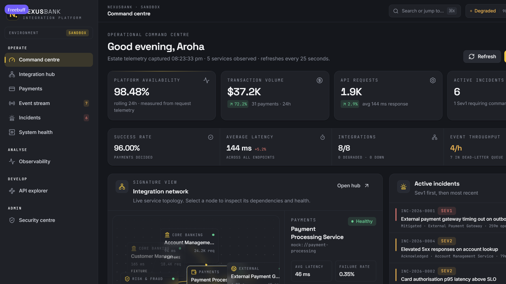
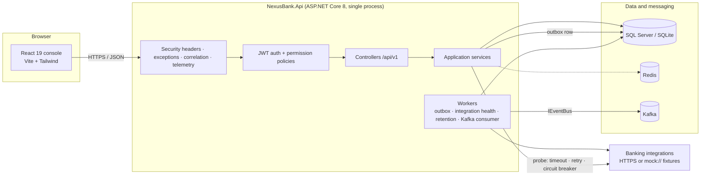
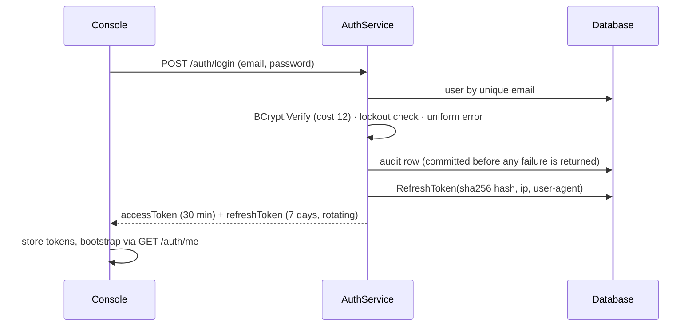
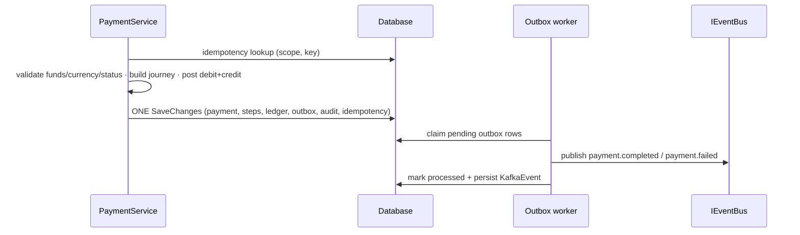
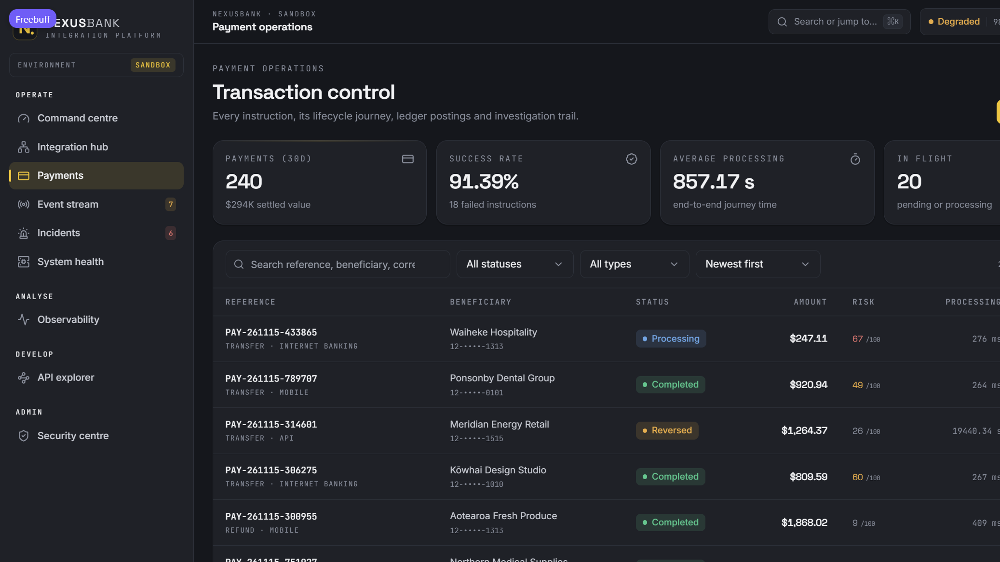
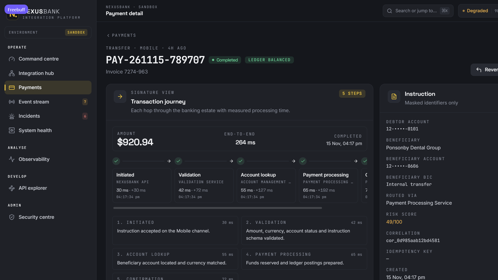
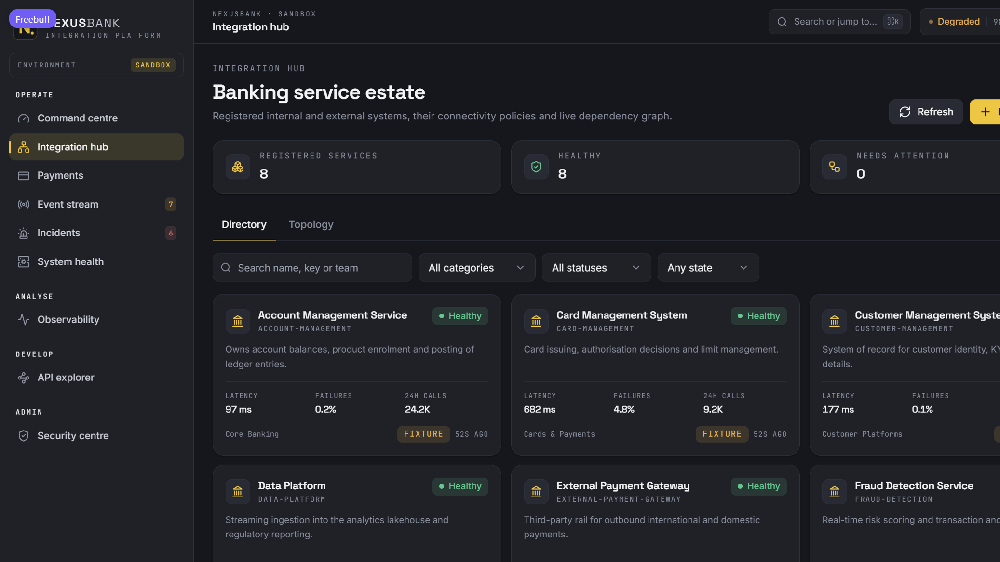
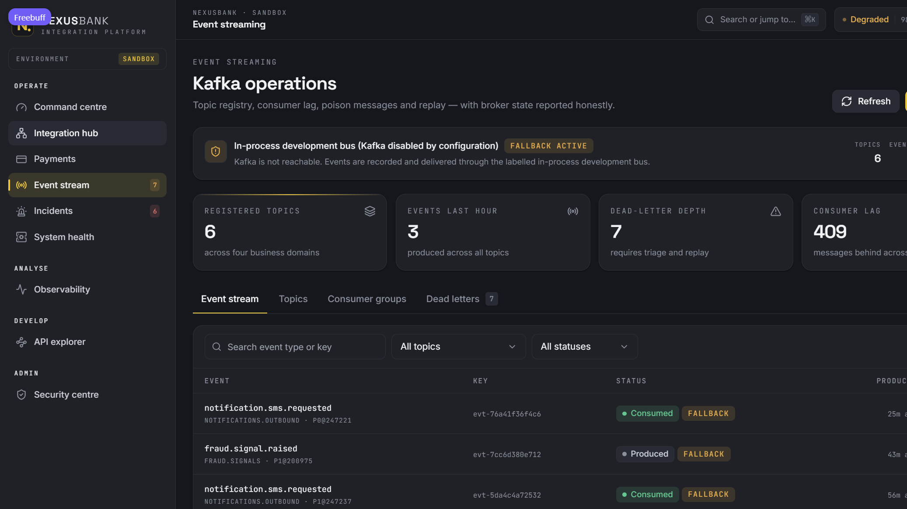
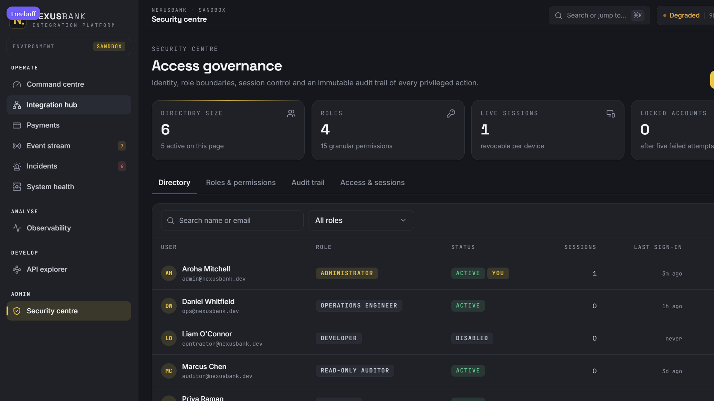

# NexusBank — Enterprise Banking Integration Platform

A working full-stack platform for running the integrations, payments, events and incidents of a banking
technology estate. **ASP.NET Core 8**, **EF Core**, **SQL Server / SQLite**, **Redis**, **Kafka**,
**React 19 + TypeScript**, and a yellow-on-charcoal operational console.

Everything on screen is backed by the API: there are no mock dashboards, no hard-coded metrics and no
buttons that do nothing. Where a dependency is unavailable the UI says so instead of pretending.

> **Synthetic data only.** No real customer, account or payment data is used. NexusBank is not affiliated
> with, endorsed by, or connected to any bank. Nothing here is a claim of regulatory compliance.

**Live demo:** <https://nexus-bank-sand.vercel.app> · sign in with `ops@nexusbank.dev` / `NexusBank!2026`



---

## 1. What it does

NexusBank is the **operational control plane** for a bank's integration estate. A bank runs dozens of
internal and third-party systems — core banking, cards, fraud, payments gateways, data platforms — and
the hard problems are not writing each integration, they are answering operational questions quickly:

| Business problem | What the platform provides |
| --- | --- |
| "Which services are up, and what depends on what?" | Integration hub with a live dependency topology, per-service health, latency and failure rate |
| "Did this payment go through, and where did it stop?" | Payment register with a per-instruction journey, processor steps, timings, failure codes and double-entry ledger postings |
| "Did we debit without crediting?" | Balanced debit/credit postings per payment, exposed as `ledgerBalanced`, with reconciliation queries |
| "Are we about to send the same payment twice?" | `Idempotency-Key` with request hashing and stored responses; replay returns the original result |
| "What events did we publish, and did they get there?" | Topic registry, consumer lag, dead-letter queue with per-message replay, and a labelled fallback when no broker is available |
| "What broke, when, and who is fixing it?" | Incident register with severity, state machine, timeline, root cause and corrective actions |
| "Who changed what, and who tried to sign in?" | Permission-based access control, session revocation, append-only audit trail, sign-in history |
| "Is this deployment healthy right now?" | Component-level health for database, cache, broker, integrations and workers — reported honestly, including deliberate fallbacks |

**Target users.** Bank operations engineers, integration/platform engineers, release and incident
managers, security administrators and auditors. **Use cases.** Integration estate monitoring, payment
operations and investigation, event-stream operations, incident response, access governance.

**Engineering context.** The interesting problems are reliability and honesty: making a multi-table
financial write atomic, making retries safe, keeping events and database state consistent, degrading
visibly when a dependency is absent, and proving every dashboard number comes from a real record.

---

## 2. Key engineering highlights

Each row states the challenge, the implementation, why it matters, and where it can be verified.

| Capability | Implementation | Engineering value | Verify |
| --- | --- | --- | --- |
| **Payment idempotency** | `Idempotency-Key` header, canonical request hash (SHA-256), stored response, 24 h expiry, unique `(Scope, Key)` index. Same key + payload → replay (`replayed: true`); same key + different payload → `409 idempotency_key_reuse` | A retried or double-submitted instruction can never create two payments — the single most important client-facing safety property in a payment API | `PaymentService.CreateAsync`, `PaymentServiceTests`, integration test |
| **Double-entry ledger** | Every completed payment posts a debit and a credit of equal amount; suspense account (`NEXUSBANK-SUSPENSE`) for beneficiaries outside the estate; entries are inserted, never updated | Books that cannot silently drift; the detail endpoint exposes `ledgerDebitTotal`, `ledgerCreditTotal`, `ledgerBalanced` | `PaymentService.PostLedger`, `docs/DATABASE.md` §4, screenshot 03 |
| **Financial transaction consistency** | Payment, journey steps, ledger entries, outbox message, audit entry and idempotency record commit in **one** `SaveChanges` | No window in which money moved but the ledger, the event or the audit trail is missing | `PaymentService.CreateAsync`, `docs/ARCHITECTURE.md` §6 |
| **Transactional outbox** | Business write + `OutboxMessages` row in the same transaction; a worker publishes every 5 s (batch 25) with exponential backoff on failure | Events are never emitted for a rolled-back payment and never lost during a broker outage — they are delayed and visible | `OutboxPublisherWorker`, ADR-004 |
| **Event-driven processing** | `IEventBus` with a Kafka producer (`Acks.All`, idempotence enabled) and an in-process fallback that labels every affected message `isSimulated: true`; consumer reconciles by `(topic, offset)` | Real streaming where a broker exists, no silent lying where it does not | `KafkaEventBus`, `KafkaEventConsumerWorker`, screenshot 05 |
| **Dead-letter handling and replay** | `POST /events/{id}/retry` republishes a stored payload and marks it `Retried`; `POST /events/{id}/dead-letter` parks one deliberately; depth is alerted | Poison messages are quarantined and can be replayed after a fix, with audit | `EventStreamService`, `ObservabilityService.GetAlertsAsync` |
| **JWT authentication** | HS256, 30 min, `sub`/`email`/`role`/`permission[]`/`iat`/`exp`, validated signature + `iss` + `aud` + lifetime (30 s skew); no `nbf` (a clock-skew regression fix) | Stateless authorisation with no per-request session lookup | `JwtTokenService`, `JwtTokenServiceTests`, ADR-006 |
| **Refresh-token rotation** | 48 random bytes, stored **only** as a SHA-256 hash, single use, rotated on every refresh, revocable per session, IP + user agent recorded | Token theft is detectable (the presented token is revoked) and a database read yields no usable token | `AuthService.RefreshAsync`, `RefreshTokens` table |
| **RBAC + permission policies** | Roles are named bundles of permissions; every action declares `[Authorize(Policy = NexusPermissions.X)]`; a custom policy provider resolves any permission code | Authorisation is declared once, enforced server-side, and cannot drift from what the UI shows | `PermissionAuthorization.cs`, ADR-007, 4 RBAC integration tests |
| **Redis caching** | `ICacheService` with Redis via `IDistributedCache`, automatic permanent demotion to `IMemoryCache` on failure, mode reported everywhere; Redis 7 in Compose | The platform keeps working when the cache is absent, and says which mode is serving | `NexusCacheService`, ADR-009, `docs/PERFORMANCE.md` §5 (read-path caching is **not** wired — stated plainly) |
| **Kafka event streaming** | Producer with idempotence and acks-all, consumer worker with lag/heartbeat reporting, topics with partitions and retention, replay and dead-letter operations | Real broker semantics where available; the same operations remain meaningful against the persisted event store | `KafkaEventBus`, `KafkaEventConsumerWorker`, `docs/ARCHITECTURE.md` §9 |
| **Structured logging** | Serilog with a fixed template, `service`/`CorrelationId`/`ClientIp` enrichment, framework noise suppressed to `Warning`, no bodies or tokens logged | A request can be reconstructed from logs without a PII leak | `Program.cs`, `docs/OBSERVABILITY.md` §3 |
| **Distributed tracing** | OpenTelemetry ASP.NET Core + `HttpClient` instrumentation, OTLP exporter only when configured, W3C trace id persisted per request alongside the correlation id | One join key from browser to database row; honest that this is request-level tracing, not span trees | `RequestTelemetryMiddleware`, `docs/OBSERVABILITY.md` §9 |
| **Health checks** | `/health/live` (liveness), `/health` (component truth + 24 h availability), `/api/v1/system/health` (operator detail with worker heartbeats) | Orchestrators restart on liveness only; operators get the truth, including deliberate degradation | `ComponentHealthProbe`, `SystemHealthService` |
| **Observability from real data** | One `ApiRequestLog` per request; dashboard, traffic, latency, error groups, traces, alerts and `/metrics` are aggregations of those rows + live probes | No invented numbers: a fresh database shows an empty dashboard until traffic exists | `RequestTelemetryMiddleware`, `ObservabilityService`, ADR-010 |
| **Automated testing** | 36 unit/service tests, 14 `WebApplicationFactory` integration tests, 19 Vitest tests — all passing as of 2026-11-15 | The risky behaviour (auth, lockout, idempotency, ledger balance, RBAC) is guarded, not assumed | `docs/TESTING.md` §1 |

Evidence also includes what is *not* done: see §17 and `docs/PERFORMANCE.md` §11 for the honest backlog.

---

## 3. Architecture overview



**Modular monolith.** One deployable API with compiler-enforced project boundaries, plus a static
console. Not microservices — the reasoning and the extraction seams are in ADR-001 and
`docs/ARCHITECTURE.md` §13.

| Module | Responsibility |
| --- | --- |
| Command centre | Operational dashboard with the interactive integration network map |
| Integration hub | Register, configure, probe, enable/disable integrations; topology and audit history |
| API explorer | Endpoint catalogue, request builder, live execution with the caller's own token, request history |
| Payment operations | Create, filter, inspect, refund and reverse payments; journey timeline and ledger postings |
| Event streaming | Topics, partitions, consumer lag, payloads, dead-letter replay, publishing |
| Observability | Traffic, latency distribution, error groups, traces, log feed, alerts, dependencies |
| Incidents | Severity-ranked register, state machine, timeline, root cause, corrective actions |
| Security centre | Directory, roles/permissions, audit trail, sessions and sign-in activity |
| System health | Live probe results for database, cache, broker, integrations and workers |

### Authentication flow (abridged)



### Payment write path (abridged)



Full sequence diagrams — request lifecycle, ledger flows, outbox, event processing, Redis, resilience:
[`docs/ARCHITECTURE.md`](docs/ARCHITECTURE.md).

### Backend projects

```
backend/
├── NexusBank.Api/                 HTTP host, controllers, middleware, auth wiring, Swagger
├── NexusBank.Application/         DTOs, validators, services (auth, payments, integrations, incidents…)
├── NexusBank.Domain/              Entities and enums (no dependencies)
├── NexusBank.Infrastructure/      EF Core context, migrations, seeder, JWT, BCrypt, Redis, Kafka
├── NexusBank.IntegrationServices/ Probe pipeline, self-API invoker, deterministic simulator
├── NexusBank.Workers/             Background workers (outbox, health, retention, consumer)
├── NexusBank.Shared/              Paging, permission constants, masking, reference formatting
└── tests/
    ├── NexusBank.Tests/           36 unit and service tests (SQLite in-memory)
    └── NexusBank.IntegrationTests/ 14 end-to-end API tests (WebApplicationFactory)
```

### Frontend structure

```
frontend/
├── src/
│   ├── components/     design system, data display, charts, topology, payment timeline
│   ├── features/       auth, dashboard, integrations, explorer, payments, events,
│   │                   observability, incidents, security, health, not-found
│   ├── hooks/          useAuth, useTheme, useReducedMotion
│   ├── lib/            api client (single-flight refresh), query client, zod schemas, formatting
│   ├── styles/         design tokens (light + dark)
│   ├── types/          API contracts
│   ├── App.tsx         routes and guards
│   └── main.tsx        providers
└── tests/              Vitest + React Testing Library; Playwright specs (optional)
```

---

## 4. Application screenshots

| | |
| --- | --- |
| **Command centre** — live aggregated telemetry, topology, incidents<br/> | **Payment operations** — register with status, risk, processing time<br/> |
| **Payment detail** — journey, timings, `LEDGER BALANCED`, correlation id<br/> | **Integration hub** — estate health with FIXTURE labelling<br/> |
| **Event stream** — topics, lag, dead letters, honest broker banner<br/> | **Security centre** — directory, roles, sessions, audit<br/> |

All six are genuine captures of the live deployment with the synthetic seeded estate. Provenance and
re-capture instructions (including a note about a small tool overlay in the top-left corner):
[`docs/screenshots/README.md`](docs/screenshots/README.md).

---

## 5. Live deployment

| Component | Where | State |
| --- | --- | --- |
| Console | Vercel — <https://nexus-bank-sand.vercel.app> | Static SPA + edge rewrites |
| API | Render — <https://nexusbank-api-w53j.onrender.com> | ASP.NET Core, single instance |
| Database | The Render instance | **SQLite** file (`Microsoft.EntityFrameworkCore.Sqlite`), created and seeded on boot |
| Redis | — | **Disabled in the current Render deployment for cost optimisation** |
| Kafka | — | **Disabled in the current Render deployment for cost optimisation** |

**Redis and Kafka are implemented and available in the project.** Both are supported in
local/containerised environments (Docker Compose runs Redis 7 and Kafka 3.7), and both are disabled in
the hosted deployment to keep it free. Their absence is *reported*, not hidden:

```json
{
  "status": "degraded",
  "database": "connected",
  "cache": "In-process memory cache (Redis unreachable)",
  "eventBus": "In-process development bus (Kafka disabled by configuration)",
  "availabilityPct": 98.417,
  "uptimeSeconds": 1320
}
```

`degraded` is the correct status for this configuration — the database is healthy, the cache and broker
are deliberately absent.

### Endpoints

| Purpose | URL |
| --- | --- |
| Console | <https://nexus-bank-sand.vercel.app> |
| API | <https://nexusbank-api-w53j.onrender.com> |
| Health (anonymous) | <https://nexusbank-api-w53j.onrender.com/health> |
| Liveness | <https://nexusbank-api-w53j.onrender.com/health/live> |
| Prometheus metrics | <https://nexusbank-api-w53j.onrender.com/metrics> |
| Swagger UI | <https://nexusbank-api-w53j.onrender.com/swagger/index.html> |
| OpenAPI JSON | <https://nexusbank-api-w53j.onrender.com/swagger/v1/swagger.json> |

Swagger is **publicly reachable** in the hosted demo — convenient for review, and documented as an
information-disclosure gap in `docs/SECURITY.md` §4.5.

### How the two hosts are wired

`frontend/vercel.json` carries two rewrites, both of which are load-bearing:

```json
{ "source": "/api/:path*", "destination": "https://nexusbank-api-w53j.onrender.com/api/:path*" },
{ "source": "/((?!api/).*)", "destination": "/index.html" }
```

The first makes API calls same-origin (no CORS dependency, no API origin in the bundle). The second is
the SPA fallback: without it, a deep link such as `/login` returns the platform's 404 page instead of the
application. Both are verified in `docs/DEPLOYMENT.md` §1.3.

### Hosted limitations (explicit)

1. **SQLite on an ephemeral filesystem** — data created during a session is lost on redeploy or restart;
   the deterministic seeded estate returns. RPO is effectively "since last boot".
2. **No Redis or Kafka instance** — no distributed cache, no broker fan-out; events are recorded and
   flagged `isSimulated: true`.
3. **Free-instance cold start** — the first request after idle takes tens of seconds.
4. **Single instance** — the outbox relay has no leader election, so it cannot simply be replicated.
5. **No backups** — see `docs/DISASTER_RECOVERY.md`; the recovery-validation table is empty by design.
6. **Rate limits keyed on the proxy address** — the 12/min auth budget is shared per proxy egress rather
   than per user (`docs/SECURITY.md` §1.5).
7. **No deployment pipeline** — Vercel and Render deploy from Git; CI does not gate them
   (`docs/CI_CD.md`).

### Environment variables (names only — values are secrets)

```
ASPNETCORE_ENVIRONMENT   Jwt__SigningKey        Jwt__Issuer          Jwt__Audience
Database__Provider       ConnectionStrings__Sqlite
Cors__AllowedOrigins__0  Redis__Enabled         Redis__Configuration
Kafka__Enabled           Kafka__BootstrapServers
OpenTelemetry__OtlpEndpoint   RateLimiting__PermitLimit   RateLimiting__AuthPermitLimit
```

The API **refuses to start** outside Development without `Jwt__SigningKey` — a deliberate fail-closed
default rather than a known fallback key.

---

## 6. Technology stack

| Area | Used | Notes |
| --- | --- | --- |
| **Frontend** | React 19, TypeScript 5.7, Vite 6, Tailwind 3, Radix primitives, TanStack Query 5, React Router 7, React Hook Form + Zod, Recharts, Lucide, Sonner | No component framework; design system built on CSS variables |
| **Backend** | ASP.NET Core 8 (`net8.0`), C# 12, dependency-injected modular monolith | 7 projects + 2 test projects |
| **Database** | SQL Server 2022 (provider of record, migrations) · SQLite (local development, tests, hosted demo) · EF Core 8 | 24 tables; provider switch via configuration |
| **Caching** | Redis 7 via `IDistributedCache`, `IMemoryCache` fallback | Implemented; on the health path, not yet on business reads |
| **Messaging** | Confluent.Kafka 2.x client, Kafka 3.7 (KRaft) in Compose, in-process fallback bus | Producer idempotence, acks-all, consumer worker |
| **Security** | JWT bearer (HS256), BCrypt.Net-Next 4.0.3 (cost 12), custom permission policies, rate limiting, security headers | See `docs/SECURITY.md` |
| **Testing** | xUnit, `WebApplicationFactory`, FluentAssertions, Vitest, React Testing Library, jsdom, Playwright (optional) | 36 + 14 + 19 tests |
| **Observability** | Serilog, OpenTelemetry (ASP.NET Core + HttpClient), Prometheus text exposition, correlation ids | OTLP exporter optional and off by default |
| **DevOps** | GitHub Actions (build, tests, migration check, container builds), multi-stage Dockerfiles, Docker Compose | No deployment job |
| **Infrastructure** | Render (hosted API), Vercel (hosted console), Azure Container Apps (documented optional target, **not deployed**) | See `docs/DEPLOYMENT.md` |

---

## 7. Quick start

### Prerequisites

- **.NET 8 SDK** (an SDK 9 install also builds `net8.0`)
- **Node 20+** (CI uses Node 22)
- Optional: **Docker Desktop** with Compose v2 and ~6 GB RAM for the full stack

### Option A — .NET SDK and Node (fastest; SQLite)

```bash
# 1. API — development profile uses SQLite, seeds itself, Redis and Kafka off
cd backend
ASPNETCORE_ENVIRONMENT=Development ASPNETCORE_URLS=http://localhost:8080 \
  dotnet run --project NexusBank.Api --no-launch-profile

# 2. Console — proxies /api, /health and /metrics to :8080
cd frontend
npm install
npm run dev        # http://127.0.0.1:5173
```

Or both at once: `./scripts/dev.sh`.

The API creates `backend/NexusBank.Api/nexusbank-dev.db` on first run and seeds the synthetic estate.
Delete that file to reseed.

### Option B — Docker Compose (SQL Server + Redis + Kafka + API + console)

```bash
cp .env.example .env          # set MSSQL_SA_PASSWORD (strong) and JWT_SIGNING_KEY
docker compose up --build
docker compose ps             # wait for api/web to be healthy
```

| Service | URL |
| --- | --- |
| Console | <http://localhost:8088> |
| API / Swagger | <http://localhost:8080/swagger> |
| Health | <http://localhost:8080/health> |
| Prometheus metrics | <http://localhost:8080/metrics> |
| SQL Server / Redis / Kafka | `localhost:1433` / `6379` / `9092` |

This is the only shape where **Redis and Kafka actually execute**. `docker compose config` validates in
this repository and CI builds both images, but the stack has **not** been started end-to-end here — treat
the first run as an unverified step.

### Database and migrations

```bash
cd backend
dotnet tool install --global dotnet-ef --version 8.0.11
export PATH="$PATH:$HOME/.dotnet/tools"

dotnet ef database update --project NexusBank.Infrastructure --startup-project NexusBank.Api
dotnet ef migrations add <Name>  --project NexusBank.Infrastructure --startup-project NexusBank.Api
dotnet ef migrations script --idempotent --project NexusBank.Infrastructure --startup-project NexusBank.Api -o migration.sql
```

The initial migration is committed at
`backend/NexusBank.Infrastructure/Migrations/20261113172523_InitialCreate.cs`.

SQLite runs the *same* model with `EnsureCreated`. Because SQLite has no native `DateTimeOffset`, the
context applies `DateTimeOffsetToBinaryConverter` **only** for SQLite (guarded by
`SqliteDateRoundTripTests`). Money is `decimal(18,2)` everywhere.

### Demo accounts

All seeded accounts use `NexusBank!2026`:

| Email | Role | Sees |
| --- | --- | --- |
| `admin@nexusbank.dev` | Administrator | Everything, including security administration |
| `ops@nexusbank.dev` | Operations Engineer | Dashboard, integrations, payments, events, incidents, health |
| `dev@nexusbank.dev` | Developer | Explorer, integrations, observability, events |
| `auditor@nexusbank.dev` | Read-Only Auditor | Read access plus the audit trail; no mutations |

Permissions are enforced by the API, not hidden in the UI: an auditor's `POST /api/v1/payments` returns
`403` even outside the console (asserted in the integration suite).

---

## 8. Configuration

Standard ASP.NET Core precedence: environment variables override `appsettings.{Environment}.json`.

| Variable | Default | Purpose |
| --- | --- | --- |
| `Database__Provider` | `SqlServer` | `SqlServer` or `Sqlite` |
| `ConnectionStrings__SqlServer` | sample value | SQL Server connection (provider of record) |
| `ConnectionStrings__Sqlite` | `Data Source=nexusbank.db` | Local development, tests, hosted demo |
| `Database__AutoMigrate` | `true` | Migrate (SQL Server) or `EnsureCreated` (SQLite) at startup |
| `Database__AutoSeed` | `true` | Seed the synthetic estate once |
| `Jwt__SigningKey` | empty | HMAC key, ≥ 32 bytes. **Required outside Development** |
| `Jwt__Issuer` / `Jwt__Audience` | `nexusbank-api` / `nexusbank-console` | Token validation |
| `Jwt__AccessTokenMinutes` | `30` | Access-token lifetime |
| `Redis__Enabled` / `Redis__Configuration` | `true` / `localhost:6379` | Distributed cache (see §5 for the hosted setting) |
| `Kafka__Enabled` / `Kafka__BootstrapServers` | `true` / `localhost:9092` | Event bus (see §5 for the hosted setting) |
| `Cors__AllowedOrigins__0..n` | localhost dev origins | Console origins allowed to call the API |
| `RateLimiting__PermitLimit` | `600` | Requests per minute per connection IP |
| `RateLimiting__AuthPermitLimit` | `12` | Login/refresh/explorer attempts per minute per connection IP |
| `OpenTelemetry__OtlpEndpoint` | empty | OTLP exporter target (off by default) |

Secrets are never committed. `.env` is ignored; `.env.example` documents every key with placeholders.
Integration credentials are **not** stored in the database — integrations keep only a `secret://`
reference (`SecretReference`), which is never returned by the API.

---

## 9. Database

SQL Server is the schema and migration provider of record; 24 tables covering identity, integrations,
banking, messaging and platform telemetry.

**Seed volume:** 6 operators, 8 integrations with health samples and audit history, 12 customers, ~20
accounts, 240 payments with journey steps and ledger postings, 6 topics, ~288 events, 8 incidents with
timelines, and a rolling 48-hour request-log history so the charts are meaningful on first load.

Key modelling decisions: `Guid` keys generated in the entity, `decimal(18,2)` money, `DateTimeOffset`
time, integers for enums with string serialisation at the API boundary, explicit `HasMaxLength`, and
indexes chosen for the actual query patterns (idempotency lookup, outbox claim, request-log windows,
per-payment journey ordering).

ERD, index inventory, integrity rules and retention: [`docs/DATABASE.md`](docs/DATABASE.md).

---

## 10. API

All endpoints are under `/api/v1`, require a bearer token unless noted, and return RFC 7807-style problem
details on failure. Interactive documentation: `/swagger`.

| Area | Endpoints |
| --- | --- |
| Auth | `POST /auth/login`, `/auth/refresh`, `/auth/logout`, `GET /auth/me`, `/auth/sessions`, `DELETE /auth/sessions/{id}`, `GET /auth/access-history` |
| Dashboard | `GET /dashboard` |
| Integrations | `GET /integrations`, `/integrations/lookup`, `/integrations/topology`, `/integrations/{id}`, `POST /integrations`, `PUT /integrations/{id}`, `PATCH /integrations/{id}/enabled`, `POST /integrations/{id}/probe`, `DELETE /integrations/{id}` |
| Payments | `GET /payments`, `/payments/stats`, `/payments/accounts`, `/payments/{id}`, `POST /payments`, `POST /payments/{id}/refund`, `POST /payments/{id}/reverse` |
| Events | `GET /events`, `/events/{id}`, `/events/topics`, `/events/consumer-groups`, `/events/status`, `POST /events/publish`, `POST /events/{id}/retry`, `POST /events/{id}/dead-letter` |
| Observability | `GET /observability/overview`, `/traffic`, `/latency`, `/errors`, `/traces`, `/logs`, `/alerts`, `/services` |
| Incidents | `GET /incidents`, `/incidents/stats`, `/incidents/{id}`, `POST /incidents`, `PATCH /incidents/{id}`, `POST /incidents/{id}/notes` |
| Security | `GET /security/users`, `POST /security/users`, `PUT /security/users/{id}`, `GET /security/roles`, `/security/permissions`, `/security/audit-logs`, `/security/events`, `/security/access-history` |
| System | `GET /system/health`, `GET /system/metrics` |
| Explorer | `GET /explorer/catalogue`, `POST /explorer/execute` |
| Core banking | `GET /customers`, `GET /accounts` |
| Anonymous | `GET /health`, `/health/live`, `/metrics`, `/swagger` |

```bash
TOKEN=$(curl -s -X POST http://localhost:8080/api/v1/auth/login \
  -H 'Content-Type: application/json' \
  -d '{"email":"admin@nexusbank.dev","password":"NexusBank!2026"}' | jq -r .accessToken)

curl -s http://localhost:8080/api/v1/dashboard -H "Authorization: Bearer $TOKEN" | jq .summary
```

Contracts, paging, filtering, error codes and the idempotency contract:
[`docs/API.md`](docs/API.md).

---

## 11. Testing and quality

```bash
# backend
cd backend
dotnet build NexusBank.sln -c Release
dotnet test tests/NexusBank.Tests                 # 36 unit/service tests
dotnet test tests/NexusBank.IntegrationTests      # 14 end-to-end API tests

# frontend
cd frontend
npm run build                                     # tsc -b + vite build (types are a gate)
npm test                                          # 19 Vitest tests
npx playwright test                               # optional e2e (needs both servers)
```

**Verified results, 2026-11-15:** 36/36 unit and service tests passed; 14/14 integration tests passed;
19/19 frontend tests passed. No coverage percentage is published because no coverage run has been
executed.

What the suites actually protect — auth and lockout, payment atomicity, idempotent replay, ledger balance,
RBAC denials, degraded-mode honesty — plus the scenarios that are **written but not implemented**
(payment concurrency, Kafka failure/replay, caching) are in [`docs/TESTING.md`](docs/TESTING.md) §4–§10.

---

## 12. Security

- JWT access tokens (30 min) with `iss`/`aud`/lifetime validation; refresh tokens are random, stored only
  as SHA-256 hashes, rotate on use and are revocable per session.
- BCrypt password hashing (cost 12, per-password salt). No plaintext password is stored, logged or
  returned.
- Permission-based authorisation through a custom policy provider; roles are compositions of permissions,
  never hard-coded controller checks.
- Lockout after five failed attempts; identical response for unknown account and wrong password; every
  authentication outcome audited **before** the rejection is returned.
- Rate limiting (600/min global, 12/min auth), explicit CORS allow-list, security headers on every
  response, `no-store` on API payloads, correlation ids, no stack traces or configuration in errors.
- 7 dependency advisories are open and tracked, not suppressed (1 high in the SQLite native provider,
  1 high and 2 critical in the frontend toolchain, moderates in OpenTelemetry).

Threat model, OWASP Top 10 mapping, vulnerability management and the production checklist with
implemented / partial / recommended status: [`docs/SECURITY.md`](docs/SECURITY.md).

**Demonstration limitations, stated openly:** tokens live in `localStorage` (XSS-readable), JWT signing is
symmetric (HS256), Swagger is public, there is no maker–checker on payments, and the demo credentials are
published. Each has a documented remediation path.

---

## 13. Observability

- **Logs:** Serilog structured console output enriched with `service`, `CorrelationId`, `ClientIp`; no
  bodies or tokens.
- **Telemetry:** one `ApiRequestLog` per request; every dashboard and observability figure is an
  aggregation of those rows plus live probes.
- **Metrics:** `/metrics` Prometheus exposition (requests/hour, 5xx/hour, mean latency, uptime, per-component
  health gauge); OpenTelemetry instrumentation with an optional OTLP exporter.
- **Traces:** correlation ids and W3C trace ids per request — request-level, not span trees.
- **Health:** liveness, readiness with component truth, operator detail with worker heartbeats.
- **Alerts:** rule-based (integration down, error rate, dead-letter depth, Sev1/Sev2 incidents, fallbacks),
  computed on read, no notification channel.

What is **not** collected (cache hit ratio, broker-side lag, host metrics, RUM, central log sink) is listed
in [`docs/OBSERVABILITY.md`](docs/OBSERVABILITY.md) §10, with a worked troubleshooting workflow in §11.

---

## 14. Performance

No load test has been executed, and none is claimed. What exists is a cost model and the measured
bottlenecks:

- Authentication costs no database round trip (permissions are claims).
- Every request writes a telemetry row — the first thing to change at volume.
- Search is an unanchored `LIKE`, safe from injection but unindexed.
- The outbox relay tops out around 5 msg/s per instance by configuration (25 per 5 s cycle).
- The console polls the dashboard every 25 s per open session; caching that read model is the highest-value
  optimisation.
- Redis is implemented but **not currently on any business read path** — enabling it does not make a query
  faster today.

A reproducible k6 plan (scenarios, thresholds, metrics to capture, results table) is in
[`docs/PERFORMANCE.md`](docs/PERFORMANCE.md) §9.

---

## 15. CI/CD and operations

**CI** (`.github/workflows/ci.yml`): .NET restore → Release build → 36 unit tests → 14 integration tests →
idempotent migration-script check → test artefacts; Node install → typecheck + build → 19 tests; then both
container images build. **No deployment job**: Vercel and Render deploy from Git, and CI does not gate them.

**Operations:**

| Document | Contents |
| --- | --- |
| [`docs/DEPLOYMENT.md`](docs/DEPLOYMENT.md) | Hosted deployment (Vercel + Render) in full, the Compose stack, and Azure as an optional future target |
| [`docs/OPERATIONS_RUNBOOK.md`](docs/OPERATIONS_RUNBOOK.md) | Twelve incident procedures with symptoms, diagnosis, recovery and validation |
| [`docs/DISASTER_RECOVERY.md`](docs/DISASTER_RECOVERY.md) | Backup/restore, RPO/RTO derived from configuration, failure scenarios, integrity queries, recovery checklist |
| [`docs/CI_CD.md`](docs/CI_CD.md) | What the pipeline does and does not do, plus proposed security and quality gates |

---

## 16. Engineering decisions

Sixteen accepted decisions and five proposed ones, each with context, problem, alternatives, decision,
rationale, consequences and trade-offs: [`docs/DECISIONS.md`](docs/DECISIONS.md).

Highlights: modular monolith over microservices (ADR-001), one `IApplicationDbContext` (ADR-002), SQL
Server plus SQLite (ADR-003), transactional outbox (ADR-004), idempotency keys (ADR-005), JWT plus rotating
refresh tokens (ADR-006), dynamic permission policies (ADR-007), visible degradation (ADR-009), telemetry as
the only observability source (ADR-010), and the hosted Vercel/Render configuration (ADR-015, ADR-016).

Proposed and **not implemented**: per-integration resilience settings (ADR-017), maker–checker (ADR-018),
optimistic concurrency on balances (ADR-019), caching the dashboard read model (ADR-020), CI security gates
(ADR-021).

---

## 17. Known limitations and roadmap

These are deliberate, documented constraints of a portfolio build — not hidden gaps.

**Deployment and infrastructure**

1. **Hosted Redis and Kafka are disabled** for cost optimisation. Both are implemented and available in
   the project and work under Docker Compose; the hosted demo reports the fallbacks. Enabling them is
   configuration plus a managed instance, not a code change.
2. **SQLite on an ephemeral filesystem** — no durability, no backups, single writer. A shared deployment
   needs a server-grade database.
3. **Nothing is deployed on Azure.** The Container Apps path is documented and unexercised.
4. **The Compose stack has not been started end-to-end here**, though `docker compose config` validates and
   CI builds both images.

**Correctness and reliability gaps (highest priority)**

5. **Payment concurrency is untested** and the funds check is vulnerable to a lost update under a
   non-serialising provider — see ADR-019 and `docs/TESTING.md` §6.1.
6. **Idempotency race** can surface as a 500 on the unique index rather than a replay (§6.2).
7. **No maker–checker** on payments or reversals (ADR-018).
8. **No leader election** on the outbox relay, so the API cannot simply be scaled out (ADR-004).

**Security**

9. Tokens in `localStorage`; HS256 shared secret; public Swagger; no encryption at rest; no MFA; seven open
   dependency advisories (remediation plan in `docs/SECURITY.md` §6.2).
10. Rate limiting and audit IPs reflect the proxy address, not the end user (`docs/SECURITY.md` §1.5).

**Operations**

11. No central log sink, no alert routing, no external uptime monitor, no backups, no recovery rehearsal.
12. No deployment pipeline or environment promotion; no automated vulnerability scanning in CI.

**Frontend**

13. No route-level code splitting (single bundle); no real-user monitoring; no virtualised tables.

**Roadmap (ordered, all proposals)**

1. Close the payment concurrency and idempotency races, with the tests in `docs/TESTING.md` §6.
2. Add maker–checker for high-value payments and all reversals.
3. Remediate the dependency advisories and add CI security gates (ADR-021).
4. Cache the dashboard and observability read models in Redis (ADR-020).
5. Map per-integration resilience settings into the probe pipeline (ADR-017).
6. Move the hosted deployment to a persistent database and enable Redis for a truthful `healthy` status.
7. Add an external smoke test, log sink and alert routing.

---

## 18. Documentation

| Document | Contents |
| --- | --- |
| [`docs/ARCHITECTURE.md`](docs/ARCHITECTURE.md) | System context, container/component view, request lifecycle, auth, payment, ledger, outbox, event, caching and resilience flows |
| [`docs/DATABASE.md`](docs/DATABASE.md) | ERD, tables, keys, indexes, conventions, seed data, retention |
| [`docs/API.md`](docs/API.md) | Every endpoint, paging, filtering, error codes, idempotency, examples |
| [`docs/SECURITY.md`](docs/SECURITY.md) | Authentication, authorisation, data protection, OWASP Top 10, threat model, advisories, production checklist |
| [`docs/OBSERVABILITY.md`](docs/OBSERVABILITY.md) | Logs, metrics, traces, correlation ids, health, worker status, gaps, troubleshooting workflow |
| [`docs/PERFORMANCE.md`](docs/PERFORMANCE.md) | Cost model, indexes, bottlenecks, caching analysis, k6 benchmark plan, targets |
| [`docs/TESTING.md`](docs/TESTING.md) | Suite inventory, verified results, scenarios, gaps, how to extend |
| [`docs/DEPLOYMENT.md`](docs/DEPLOYMENT.md) | Hosted deployment, Compose stack, Azure target, configuration matrix, checklist |
| [`docs/OPERATIONS_RUNBOOK.md`](docs/OPERATIONS_RUNBOOK.md) | Incident procedures for API, proxy, database, Redis, Kafka, lag, dead letters, payments, duplicates, auth, latency, workers |
| [`docs/DISASTER_RECOVERY.md`](docs/DISASTER_RECOVERY.md) | Backup/restore, RPO/RTO, failure scenarios, integrity verification, recovery validation evidence |
| [`docs/CI_CD.md`](docs/CI_CD.md) | Pipeline stages, gaps, deployment reality, proposed gates |
| [`docs/DECISIONS.md`](docs/DECISIONS.md) | Architecture decision records (accepted and proposed) |
| [`docs/screenshots/README.md`](docs/screenshots/README.md) | Screenshot provenance and re-capture instructions |
| [`CONTRIBUTING.md`](CONTRIBUTING.md) | Local workflow, code conventions, review checklist |
| [`CHANGELOG.md`](CHANGELOG.md) | Notable changes, starting from this documentation release |

---

## 19. Repository layout

```
.
├── backend/                 .NET 8 solution (Api, Application, Domain, Infrastructure,
│                            IntegrationServices, Workers, Shared, tests)
├── frontend/                React 19 + TypeScript console, tests, nginx config, vercel.json
├── infrastructure/
│   ├── docker/              container notes
│   └── monitoring/          Prometheus scrape configuration
├── docs/                    architecture, database, API, security, observability, performance,
│   └── screenshots/         testing, deployment, runbook, DR, CI/CD, decisions, screenshots
├── scripts/                 dev.sh (both servers), verify.sh
├── .github/workflows/ci.yml CI pipeline
├── docker-compose.yml       SQL Server + Redis + Kafka + API + console
├── .env.example             every environment variable, no secrets
└── README.md
```

Built with C#, .NET 8, EF Core, SQL Server/SQLite, Redis, Kafka, React 19 and TypeScript.

**Licence:** no licence file is included. The repository is public for review; if you intend to reuse the
code, a licence needs to be chosen (MIT or Apache-2.0 are the usual options for a portfolio project) — this
is deliberately not decided unilaterally.
