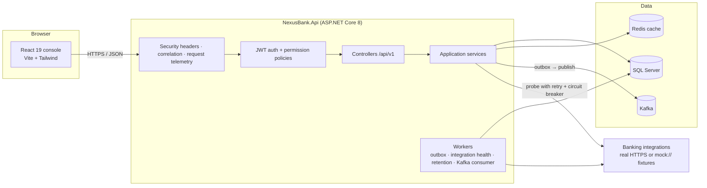

# NexusBank — Enterprise Banking Integration Platform

A working full-stack platform for running the integrations, payments, events and incidents of a
banking technology estate. Built as a portfolio project: **ASP.NET Core 8**, **EF Core**, **SQL
Server**, **Redis**, **Kafka**, **React 19 + TypeScript**, and a yellow-on-charcoal operational
console.

Everything you see is backed by the API. There are no mock dashboards, no hard-coded metrics and no
buttons that do nothing. Where a dependency is unavailable the UI says so instead of pretending.

> **Synthetic data only.** No real customer, account or payment data is used. NexusBank is not
> affiliated with, endorsed by, or connected to any bank.

---

## 1. What it demonstrates

| Area | Implementation |
| --- | --- |
| Backend architecture | Modular monolith: Domain / Application / Infrastructure / IntegrationServices / Workers / Api, with one `IApplicationDbContext` abstraction |
| Data | SQL Server as provider of record, EF Core migrations, 24 tables, indexed lookups, seeded synthetic estate |
| Reliability | Outbox pattern, idempotent payments, retry with exponential backoff, circuit breaker, atomic multi-table writes |
| Messaging | Kafka producer with a labelled in-process fallback; consumer groups, lag, dead letters and replay |
| Security | JWT access tokens, rotating hashed refresh tokens, BCrypt (work factor 12), permission policies, lockout, audit trail, rate limiting, security headers |
| Observability | Request-log-derived metrics, traces, log feed, Prometheus `/metrics`, OpenTelemetry traces/metrics, health probes |
| Frontend | React 19, TypeScript, Vite, Tailwind, TanStack Query, React Router, Recharts, React Hook Form + Zod |
| Testing | xUnit unit + WebApplicationFactory integration suites, Vitest + React Testing Library component tests |
| Delivery | Multi-stage Dockerfiles, Docker Compose, GitHub Actions CI, Azure deployment guidance |

### Modules

1. **Command centre** — operational dashboard with an interactive integration network map.
2. **Integration hub** — register, configure, probe, enable/disable integrations; topology and audit history.
3. **API explorer** — endpoint catalogue, request builder, live execution against this API, request history.
4. **Payment operations** — create, filter, inspect, refund and reverse payments; journey timeline and double-entry ledger.
5. **Event streaming** — topics, partitions, consumer lag, event payloads, dead-letter replay, publishing.
6. **Observability** — traffic, latency distribution, error groups, traces, structured logs, alerts, dependencies.
7. **Incidents** — severity-ranked register, state machine, timeline, root cause and corrective actions.
8. **Security centre** — directory, roles and permissions, audit trail, sessions and sign-in activity.
9. **System health** — live probe results for database, cache, broker, integrations and workers.

---

## 2. Architecture



Key decisions are recorded in [`docs/DECISIONS.md`](docs/DECISIONS.md). The full architecture,
request lifecycle and data flow are in [`docs/ARCHITECTURE.md`](docs/ARCHITECTURE.md).

### Backend projects

```
backend/
├── NexusBank.Api/                 HTTP host, controllers, middleware, auth wiring, Swagger
├── NexusBank.Application/         DTOs, validators, services (auth, payments, integrations, incidents…)
├── NexusBank.Domain/              Entities and enums
├── NexusBank.Infrastructure/      EF Core context, migrations, seeder, JWT, password hashing, Redis, Kafka
├── NexusBank.IntegrationServices/ Probes, circuit breaker, self-API invoker, deterministic simulator
├── NexusBank.Workers/             Background workers (outbox, health, retention, consumer)
├── NexusBank.Shared/              Paging, permission constants, reference formatting
└── tests/
    ├── NexusBank.Tests/           xUnit unit and service tests (SQLite in-memory)
    └── NexusBank.IntegrationTests/ WebApplicationFactory end-to-end API tests
```

### Frontend structure

```
frontend/
├── src/
│   ├── components/     design system, data display, charts, topology, payments timeline
│   ├── features/       auth, dashboard, integrations, explorer, payments, events,
│   │                   observability, incidents, security, health, not-found
│   ├── hooks/          useAuth, useTheme, useReducedMotion
│   ├── lib/            api client, query client, zod schemas, formatting
│   ├── styles/         design tokens (light + dark)
│   ├── types/          API contracts
│   ├── App.tsx         routes and guards
│   └── main.tsx        providers
└── tests/              Vitest + React Testing Library
```

---

## 3. Run it locally

### Option A — .NET SDK and Node (fastest, SQLite)

Prerequisites: .NET 8 SDK, Node 20+.

```bash
# 1. API — development profile uses SQLite and seeds itself
cd backend
ASPNETCORE_ENVIRONMENT=Development ASPNETCORE_URLS=http://localhost:8080 \
  dotnet run --project NexusBank.Api --no-launch-profile
```

```bash
# 2. Console
cd frontend
npm install
npm run dev        # http://127.0.0.1:5173, proxies /api, /health and /metrics to :8080
```

The API creates `backend/NexusBank.Api/nexusbank-dev.db` on first run and seeds the synthetic
estate. Delete that file to reseed from scratch.

### Option B — Docker Compose (SQL Server, Redis, Kafka, API, console)

Prerequisites: Docker Desktop with a running engine.

```bash
cp .env.example .env          # set MSSQL_SA_PASSWORD and JWT_SIGNING_KEY
docker compose up --build
```

| Service | URL |
| --- | --- |
| Console | http://localhost:8088 |
| API | http://localhost:8080 |
| Swagger | http://localhost:8080/swagger |
| Health | http://localhost:8080/health |
| Prometheus metrics | http://localhost:8080/metrics |

The API waits for SQL Server and Redis health checks, applies migrations, seeds once, then serves.
Kafka is reachable at `kafka:9092` inside the network.

### Demo accounts

All seeded accounts use `NexusBank!2026`:

| Email | Role | Sees |
| --- | --- | --- |
| `admin@nexusbank.dev` | Administrator | Everything, including security administration |
| `ops@nexusbank.dev` | Operations Engineer | Dashboard, integrations, payments, events, incidents, health |
| `dev@nexusbank.dev` | Developer | Explorer, integrations, observability, events |
| `auditor@nexusbank.dev` | Read-Only Auditor | Read access plus audit trail; no mutations |

Permissions are enforced by the API, not just hidden in the UI: an auditor's `POST /api/v1/payments`
returns `403` even if the request is made outside the console.

---

## 4. Configuration

Configuration follows standard ASP.NET Core precedence (environment variables override
`appsettings.{Environment}.json`). Full reference in [`docs/DEPLOYMENT.md`](docs/DEPLOYMENT.md).

| Variable | Default | Purpose |
| --- | --- | --- |
| `Database__Provider` | `SqlServer` | `SqlServer` or `Sqlite` |
| `ConnectionStrings__SqlServer` | sample value | SQL Server connection (migrations provider of record) |
| `ConnectionStrings__Sqlite` | `Data Source=nexusbank.db` | Local development / test database |
| `Database__AutoMigrate` | `true` | Migrate (SQL Server) or `EnsureCreated` (SQLite) at startup |
| `Database__AutoSeed` | `true` | Seed the synthetic estate once |
| `Jwt__SigningKey` | empty | HMAC key, ≥ 32 bytes. **Required outside Development** |
| `Jwt__Issuer` / `Jwt__Audience` | `nexusbank-api` / `nexusbank-console` | Token validation |
| `Redis__Enabled` / `Redis__Configuration` | `true` / `localhost:6379` | Distributed cache |
| `Kafka__Enabled` / `Kafka__BootstrapServers` | `true` / `localhost:9092` | Event bus |
| `Cors__AllowedOrigins__0..n` | localhost dev origins | Console origins allowed to call the API |
| `RateLimiting__PermitLimit` | `600` | Requests per minute per IP |
| `RateLimiting__AuthPermitLimit` | `12` | Login/explorer attempts per minute per IP |
| `OpenTelemetry__OtlpEndpoint` | empty | OTLP exporter target |

Secrets are never committed. `.env` is ignored; `.env.example` documents every key. Integration
credentials are *not* stored in the database — integrations keep only a `secret://` reference
(`SecretReference`) and never expose it through the API.

---

## 5. Database

SQL Server is the schema and migration provider of record:

```bash
cd backend
dotnet tool install --global dotnet-ef --version 8.0.11
export PATH="$PATH:$HOME/.dotnet/tools"

# apply migrations
dotnet ef database update --project NexusBank.Infrastructure --startup-project NexusBank.Api

# add a migration after a model change
dotnet ef migrations add <Name> --project NexusBank.Infrastructure --startup-project NexusBank.Api

# generate an idempotent SQL script for a DBA
dotnet ef migrations script --idempotent --project NexusBank.Infrastructure --startup-project NexusBank.Api -o migration.sql
```

The initial migration is committed at
`backend/NexusBank.Infrastructure/Migrations/20261113172523_InitialCreate.cs`.

SQLite is used for local development and tests with the *same* EF model. Because SQLite has no
native `DateTimeOffset`, the context applies a value converter **only** when the provider is SQLite
(`DateTimeOffsetToBinaryConverter`); SQL Server keeps its native `datetimeoffset`. Money is
`decimal(18,2)` everywhere.

Seed volume: 6 operators, 8 integrations with health samples and audit history, 12 customers,
~20 accounts, 240 payments with journey steps and ledger postings, 6 topics, ~288 events, 8
incidents with timelines, and a rolling 48-hour request-log history.

Entity relationships, indexes and constraints are documented in
[`docs/DATABASE.md`](docs/DATABASE.md).

---

## 6. API

All endpoints are under `/api/v1`, require a bearer token unless noted, and return RFC 7807-style
problem details on failure. Interactive documentation: `/swagger`.

| Area | Endpoints |
| --- | --- |
| Auth | `POST /auth/login`, `POST /auth/refresh`, `POST /auth/logout`, `GET /auth/me`, `GET /auth/sessions`, `DELETE /auth/sessions/{id}` |
| Dashboard | `GET /dashboard` |
| Integrations | `GET /integrations`, `GET /integrations/{id}`, `GET /integrations/topology`, `POST /integrations`, `PUT /integrations/{id}`, `PATCH /integrations/{id}/enabled`, `POST /integrations/{id}/probe`, `DELETE /integrations/{id}` |
| Payments | `GET /payments`, `GET /payments/stats`, `GET /payments/accounts`, `GET /payments/{id}`, `POST /payments`, `POST /payments/{id}/refund`, `POST /payments/{id}/reverse` |
| Events | `GET /events`, `GET /events/topics`, `GET /events/consumer-groups`, `GET /events/status`, `POST /events/publish`, `POST /events/{id}/retry`, `POST /events/{id}/dead-letter` |
| Observability | `GET /observability/overview`, `/traffic`, `/latency`, `/errors`, `/traces`, `/logs`, `/alerts`, `/services` |
| Incidents | `GET /incidents`, `GET /incidents/stats`, `GET /incidents/{id}`, `POST /incidents`, `PATCH /incidents/{id}`, `POST /incidents/{id}/notes` |
| Security | `GET /security/users`, `POST /security/users`, `PUT /security/users/{id}`, `GET /security/roles`, `GET /security/permissions`, `GET /security/audit-logs`, `GET /security/events`, `GET /security/access-history` |
| System | `GET /system/health`, `GET /system/metrics` |
| Explorer | `GET /explorer/catalogue`, `POST /explorer/execute` |
| Core banking | `GET /customers`, `GET /accounts` |
| Anonymous | `GET /health`, `GET /health/live`, `GET /metrics`, `/swagger` |

```bash
TOKEN=$(curl -s -X POST http://localhost:8080/api/v1/auth/login \
  -H 'Content-Type: application/json' \
  -d '{"email":"admin@nexusbank.dev","password":"NexusBank!2026"}' | jq -r .accessToken)

curl -s http://localhost:8080/api/v1/dashboard -H "Authorization: Bearer $TOKEN" | jq .summary
```

Request/response contracts, filtering, paging and idempotency: [`docs/API.md`](docs/API.md).

---

## 7. Testing

```bash
# backend
cd backend
dotnet test tests/NexusBank.Tests                 # 36 unit/service tests
dotnet test tests/NexusBank.IntegrationTests      # 14 end-to-end API tests

# frontend
cd frontend
npm test                                          # 19 Vitest tests
npx playwright test                               # optional e2e (requires running servers)
```

Both suites run in GitHub Actions ([`.github/workflows/ci.yml`](.github/workflows/ci.yml)),
alongside a Release build, a migration-script generation check, and Docker image builds.

What is covered, what is not, and how to extend the suites: [`docs/TESTING.md`](docs/TESTING.md).

---

## 8. Security

- JWT access tokens (30 minutes) with `iss`/`aud`/lifetime validation; refresh tokens are random,
  stored only as SHA-256 hashes, rotate on use and are revocable per session.
- BCrypt password hashing (work factor 12, per-password salt). No plaintext password is stored,
  logged or returned.
- Permission-based authorization via a custom policy provider; roles are compositions of
  permissions, never hard-coded checks in controllers.
- Lockout after five failed attempts, identical error for unknown account and wrong password.
- Failed *and* successful sign-ins are persisted to the audit log — the write happens before the
  exception is thrown.
- Rate limiting per IP (global and stricter auth policy), restricted CORS, security headers,
  HSTS in production, request-size and input validation via FluentValidation.
- Correlation IDs on every response; errors never leak stack traces or connection strings.

Threat model, residual risks (token storage in `localStorage`, mock fixtures, no mTLS in the demo)
and hardening steps: [`docs/SECURITY.md`](docs/SECURITY.md).

---

## 9. Deployment

The recommended target is **Azure Container Apps** with Azure SQL, Azure Cache for Redis, Event Hubs
(Kafka surface), Azure Container Registry, Key Vault and Application Insights — a managed,
scale-to-zero container platform that fits this containerised API plus static console without
operating Kubernetes.

Step-by-step commands (provision, build, push, configure secrets, deploy, verify, roll back), the
AKS/Helm alternative, and the configuration differences between environments are in
[`docs/DEPLOYMENT.md`](docs/DEPLOYMENT.md).

---

## 10. Known limitations

These are deliberate, documented constraints of a portfolio build — not hidden gaps.

1. **Docker was not available in the authoring environment.** `docker compose up` and the container
   images could not be executed here; they are provided and reviewed but not run-verified. Local
   verification used the .NET 8 SDK and Vite directly.
2. **No cloud deployment is live.** Nothing is deployed or claimed to be.
3. **SQLite in development.** The local database is SQLite; SQL Server is the migration provider of
   record and the migration script is generated and committed, but it has not been executed against
   a running SQL Server instance here.
4. **Simulated integrations.** Seeded integrations use `mock://` URLs served by a deterministic
   simulator and are labelled *fixture* throughout the UI. Only integrations with real `https://`
   URLs are probed over the network.
5. **Kafka and Redis are optional.** In this environment both are disabled by configuration; the API
   reports an in-process fallback in `/health`, the health centre and the event stream. With
   `docker compose` they connect to real services.
6. **Explorer self-invocation** executes through HTTP against the API's own base URL. In the
   in-memory test host there is no TCP listener, so that one hop is verified manually against a
   running server (see `docs/TESTING.md`).
7. **Tokens live in `localStorage`**, which is XSS-readable. The hardened alternative is an
   HttpOnly, `SameSite=Strict` cookie with CSRF tokens — see `docs/SECURITY.md`.
8. **No screenshot assets are committed.** The console is running locally; capture your own from
   the live UI rather than shipping stale images.

---

## 11. Documentation

| Document | Contents |
| --- | --- |
| [`docs/ARCHITECTURE.md`](docs/ARCHITECTURE.md) | Layers, request lifecycle, payment write path, event flow, workers |
| [`docs/DATABASE.md`](docs/DATABASE.md) | ERD, tables, keys, indexes, conventions, seed data |
| [`docs/API.md`](docs/API.md) | Every endpoint, paging, filtering, errors, idempotency, examples |
| [`docs/SECURITY.md`](docs/SECURITY.md) | Auth flows, RBAC matrix, audit, threat model, residual risk |
| [`docs/TESTING.md`](docs/TESTING.md) | Test strategy, what each suite proves, how to run and extend |
| [`docs/DEPLOYMENT.md`](docs/DEPLOYMENT.md) | Local, Compose, Azure Container Apps, AKS, operations |
| [`docs/DECISIONS.md`](docs/DECISIONS.md) | Architecture decision records and their trade-offs |

---

## 12. Repository layout

```
.
├── backend/                 .NET 8 solution (Api, Application, Domain, Infrastructure,
│                            IntegrationServices, Workers, Shared, tests)
├── frontend/                React 19 + TypeScript console and its tests
├── infrastructure/
│   ├── docker/              notes and supporting container assets
│   └── monitoring/          Prometheus scrape configuration
├── docs/                    architecture, database, API, security, testing, deployment, decisions
├── scripts/                 developer helpers
├── .github/workflows/ci.yml CI pipeline
├── docker-compose.yml       SQL Server + Redis + Kafka + API + console
├── .env.example             every environment variable, no secrets
└── README.md
```

Built with C#, .NET 8, EF Core, SQL Server, Redis, Kafka, React 19 and TypeScript.
