# Architecture

NexusBank is a **modular monolith**: one deployable API with enforced internal boundaries, plus a
separate static console. The goal is enterprise clarity without the operational cost of services that
exist only to look distributed.

Two deployment shapes exist and they behave differently — read §2 before quoting any capability:

| Shape | API | Console | Database | Redis | Kafka |
| --- | --- | --- | --- | --- | --- |
| **Hosted** (current) | Render | Vercel | SQLite (ephemeral) | disabled for cost | disabled for cost |
| **Full stack** (local/Containers) | Docker Compose | nginx in Compose | SQL Server 2022 | Redis 7 | Kafka 3.7 (KRaft) |

Redis and Kafka are **implemented and available in the project** and **supported in local/containerised
environments**; both are **disabled in the current Render deployment for cost optimisation**. Every
diagram below marks which parts are active in the hosted shape.

---

## 1. System context

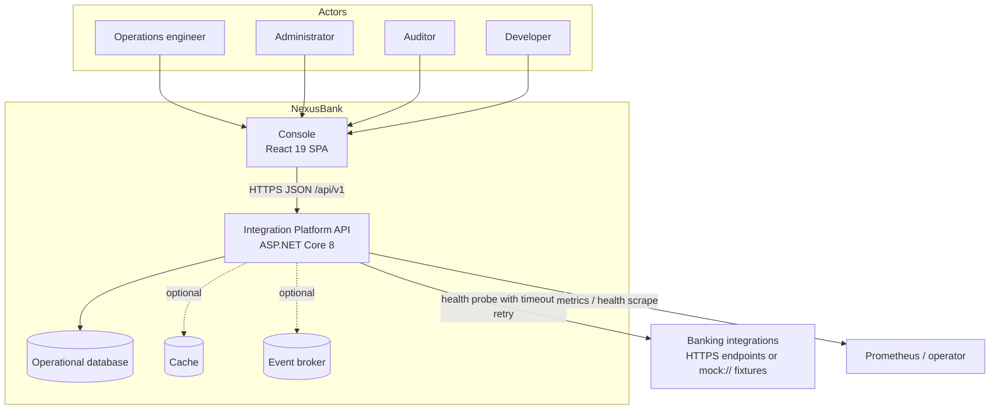

Solid lines are always active. Dotted lines are optional dependencies that degrade visibly when absent
(the API reports the fallback in `/health`, the health centre and the event stream).

**What the platform is for.** It is the operational control plane for a bank's integration estate:
which services exist, how they depend on each other and whether they are healthy; the payment
instructions flowing through them with their ledger postings and journey; the events those operations
produce; the incidents they cause; and the security/audit evidence around all of it.

**What it is not.** Not a core banking system, not a payment switch, not a customer-facing banking app.
It is the operations and integration layer around those systems, populated with synthetic data.

---

## 2. Container and component view

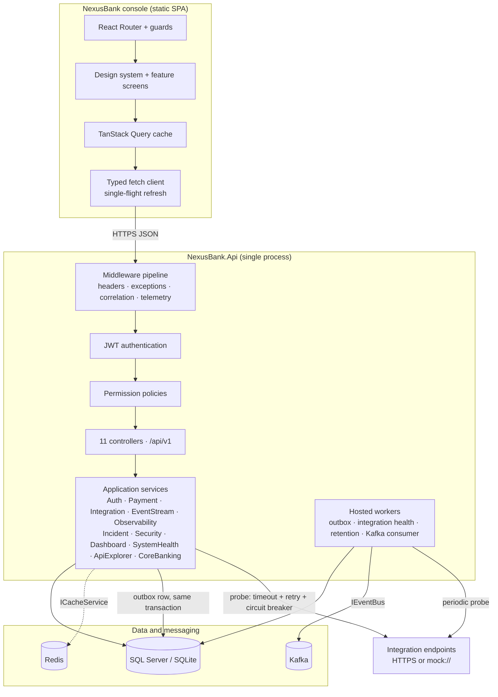

### Backend projects and dependency rules

```
backend/
├── NexusBank.Api/                 HTTP host, controllers, middleware, auth wiring, Swagger
├── NexusBank.Application/         DTOs, validators, services, interfaces it owns
├── NexusBank.Domain/              Entities and enums — no dependencies
├── NexusBank.Infrastructure/      EF Core context, migrations, seeder, JWT, BCrypt, Redis, Kafka
├── NexusBank.IntegrationServices/ Probe pipeline, self-API invoker, deterministic simulator
├── NexusBank.Workers/             BackgroundService implementations
├── NexusBank.Shared/              Paging, permission constants, masking, reference formatting
└── tests/
    ├── NexusBank.Tests/           36 unit/service tests (SQLite in-memory)
    └── NexusBank.IntegrationTests/ 14 end-to-end API tests (WebApplicationFactory)
```

Rules that keep the boundaries honest:

- **Domain** has no dependencies; entities, enums and domain rules only.
- **Application** depends on Domain and on interfaces it owns. It never references EF Core's provider,
  ASP.NET Core, Redis, Kafka or BCrypt. Services receive `IApplicationDbContext`, `ICurrentUser`,
  `ICacheService`, `IEventBus`, `IDateTimeProvider`.
- **Infrastructure** implements those interfaces. Only this project knows SQL Server, SQLite, Redis,
  Kafka, BCrypt and JWT signing.
- **Api** composes everything, owns HTTP concerns, and contains no business rules.
- **Workers** are `BackgroundService` implementations registered by the Api host.
- **IntegrationServices** owns outbound HTTP: resilience pipeline, URL building, fixture simulation.

There is exactly **one** DbContext abstraction (`IApplicationDbContext`) rather than a repository per
aggregate. EF Core is already a unit of work with composable queries; wrapping it again would add
indirection without safety. The trade-off (Application references EF Core types) is recorded in
`docs/DECISIONS.md` ADR-002.

---

## 3. Frontend ↔ backend contract

The console calls same-origin relative paths (`/api/v1/...`). In each environment that is resolved
differently:

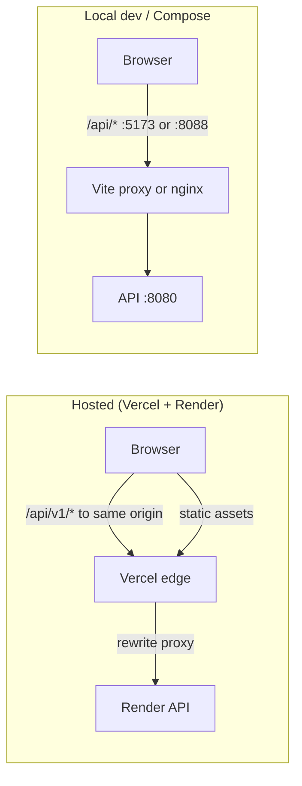

Consequences worth knowing:

- **CORS is rarely exercised**: the browser sees a same-origin request in every documented setup, so
  the `Cors:AllowedOrigins` allow-list matters only for direct cross-origin calls.
- **The Vercel rewrite is application routing.** `frontend/vercel.json` must proxy `/api/*` to the live
  API origin *and* provide an SPA fallback so client routes (`/login`, `/payments`) are served
  `index.html`. Omitting the fallback makes deep links a platform 404 — a deployment defect that looks
  like an application bug.
- **Rate limiting sees the proxy, not the user.** Neither Vercel nor the API's `RemoteIpAddress` is the
  end-user address without forwarded-header handling (`docs/SECURITY.md` §1.5).

Client-side behaviour that matters architecturally:

- TanStack Query owns server state (`staleTime 15 s`, `gcTime 5 min`, `retry 1`, no refetch on window
  focus) so navigation does not re-fetch everything.
- One typed `fetch` wrapper adds the bearer token, parses problem details into `ApiError`, and performs
  **single-flight refresh**: on `401` one refresh is attempted, concurrent callers share it, and repeated
  failure clears the session and emits a sign-out event.
- Route guards read the same permission codes the API enforces; hiding a control is convenience, never
  the security decision.

---

## 4. Request lifecycle

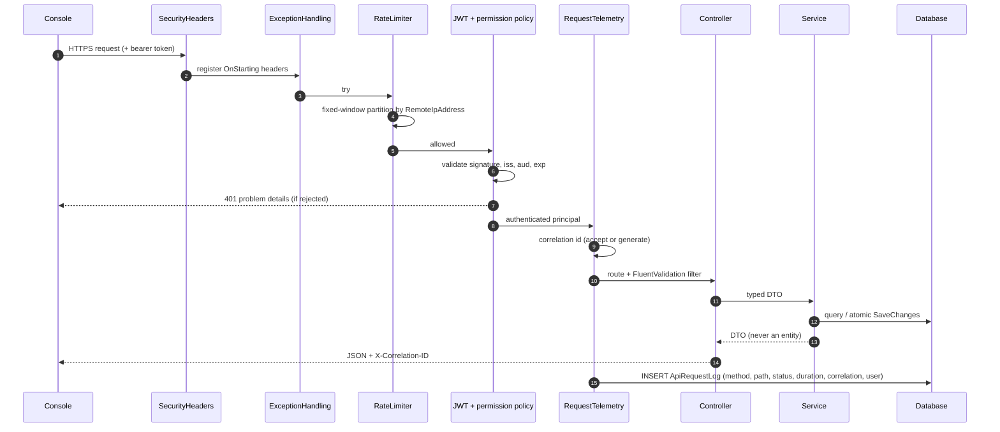

Ordering is deliberate:

- Security headers are attached in `OnStarting`, so they survive error responses.
- Telemetry runs **after** authentication (so `UserId` is populated) and **before** authorization (so
  `403`s are still measured).
- `/health`, `/metrics`, `/swagger`, `/favicon` and `OPTIONS` are excluded from telemetry to avoid
  polluting the traffic charts with probes.

Errors are centralised in `ExceptionHandlingMiddleware`: domain exceptions map to
`400/401/403/404/409/429` with a `code`, unexpected exceptions become a generic `500` with a
correlation id and a Serilog error entry. Stack traces never reach the client.

---

## 5. Authentication and authorisation flow

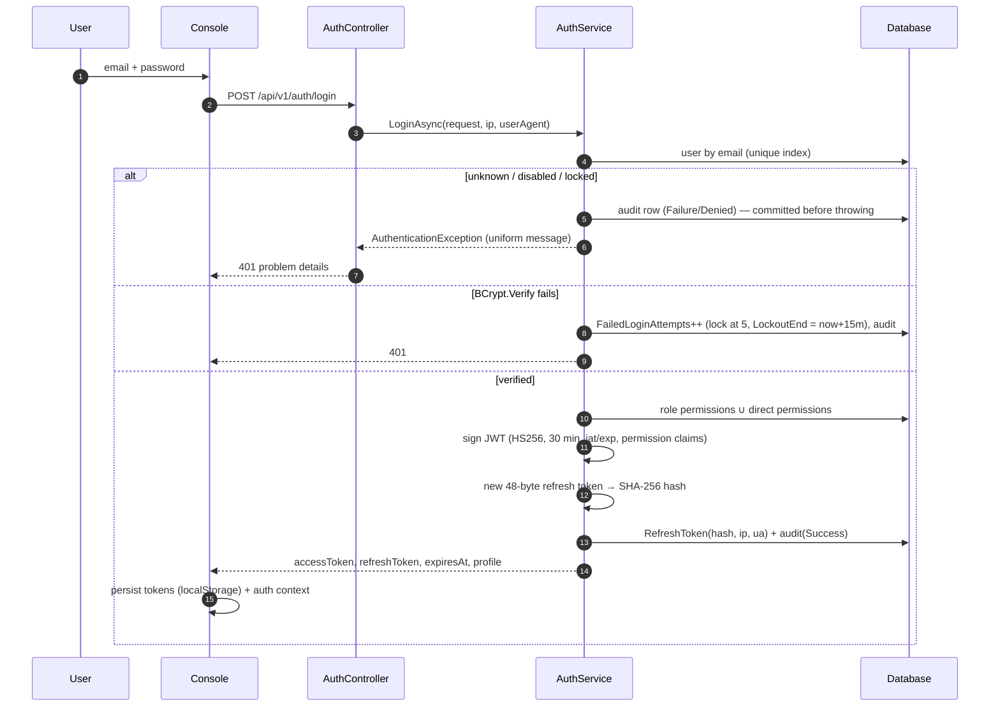

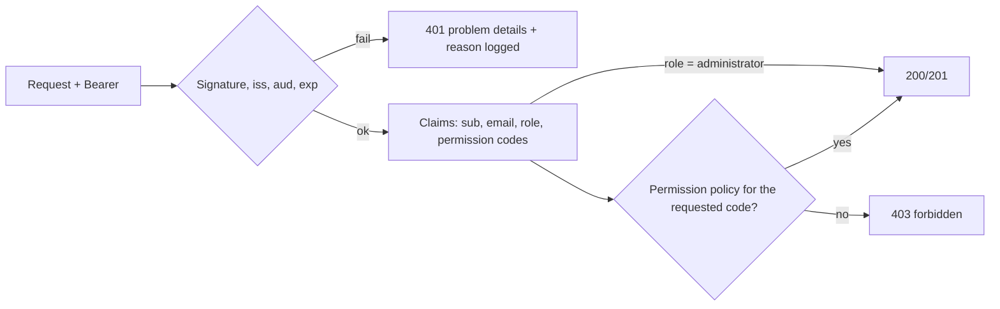

Role changes require `security:write`; permissions are claims inside the token, so a permission change
takes effect on the next token, not immediately. That is the standard trade-off of stateless
authorisation, and it is why access tokens are short-lived (30 minutes). Session revocation invalidates
the refresh token immediately; the access token expires naturally.

---

## 6. Payment write path — atomicity and idempotency

A payment is the strictest write in the platform: multiple tables must agree, and a retry must never
create a second instruction.

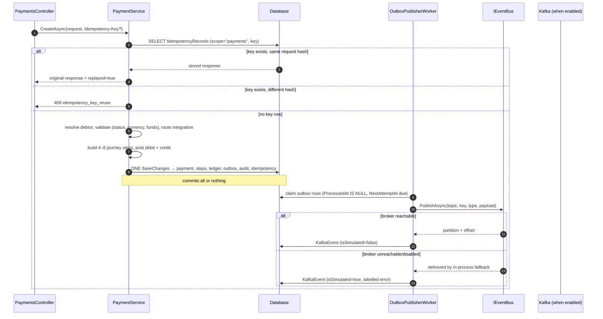

Guarantees this design provides:

| Guarantee | Mechanism |
| --- | --- |
| All-or-nothing write | Single `SaveChanges` for payment + journey + ledger + outbox + audit + idempotency |
| Replay safety | Unique `(Scope, Key)` index, canonical request hash, stored response for 24 h |
| Honest failure | Rejected instruction persists with `Failed`, a code, a reason, and **no ledger postings** |
| Balanced books | `LedgerDebitTotal == LedgerCreditTotal`, exposed as `ledgerBalanced` |
| No overdraft | `ValidateInstruction` rejects amount > `AvailableBalance`; accounts are debited only on `Completed` |
| Event/transaction consistency | The event is a row in the same transaction; delivery is a separate, retried step |

Refunds and reversals reuse the pattern with their own guards: refunds only from `Completed` and never
above the original amount; reversals only from `Completed`, posting the mirror image of the original
entries.

---

## 7. Double-entry ledger flow

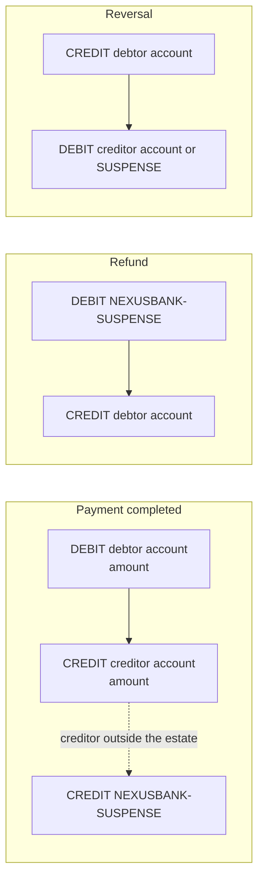

- Every entry carries `PaymentId`, account (id + number), `EntryType`, `Amount`, `Currency`, `PostedAt`
  and a description. Entries are **inserted, never updated** — history is immutable.
- The suspense account (`NEXUSBANK-SUSPENSE`) is used when the beneficiary is outside the modelled
  estate, so a completed payment always has two postings and always balances.
- Account balances are adjusted in the same transaction as the postings, so the ledger and the account
  balance cannot drift on the happy path.
- A failed payment writes **no** ledger entries; the detail endpoint exposes `ledgerBalanced = true`
  trivially (no entries) and the journey shows where it stopped.
- Money is `decimal(18,2)` end to end, rounded with banker's rounding at creation — never floating point.

Verification queries for reconciliation are in `docs/DISASTER_RECOVERY.md` §11.

---

## 8. Transactional outbox

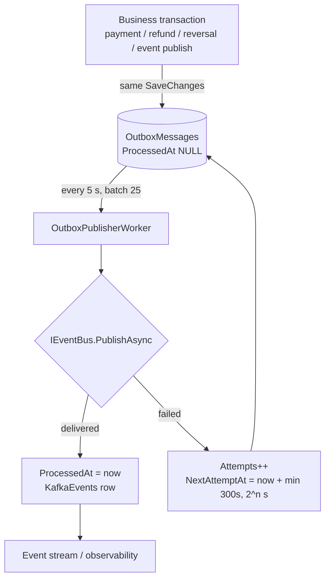

Why this shape:

- Publishing inside the business transaction would either emit events for rolled-back writes (publish
  before commit) or lose them (publish after commit). The outbox makes the event part of the commit and
  the delivery a retried side effect.
- Delivery is **at-least-once**, so consumers must be idempotent. The platform's own consumer reconciles
  by `(topic, offset)` and marks `ConsumedAt`.
- A broker outage delays events instead of dropping them: rows stay pending with a visible `Attempts`
  count and `Error`.
- There is no leader election. Running two API instances would have both workers claim the same pending
  rows — acceptable under at-least-once semantics but wasteful, and a documented scaling constraint.

---

## 9. Event processing and the fallback contract

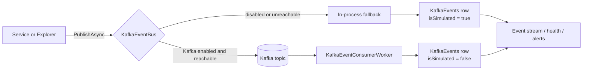

`IEventBus` exposes `Mode` and `BrokerConnected`, and both the health centre and event stream render them
**verbatim**. The strings are the contract:

- `"Apache Kafka (localhost:9092)"` — a real broker is connected.
- `"In-process development bus (Kafka disabled by configuration)"` — switched off deliberately.
- `"In-process development bus (Kafka unreachable at …)"` — configured but not answering.

The same discipline applies to Redis (`"Redis (…)"` vs `"In-process memory cache (Redis unreachable)"`).
Nothing is dressed up as healthy.

Operational capabilities implemented in the event workspace:

| Capability | Endpoint / component |
| --- | --- |
| Topic registry with partitions, retention, owner | `GET /api/v1/events/topics` |
| Live stream status (mode, broker, lag, dead letters) | `GET /api/v1/events/status` |
| Publish with JSON validation | `POST /api/v1/events/publish` |
| Replay a failed or dead-lettered event | `POST /api/v1/events/{id}/retry` |
| Park an event deliberately | `POST /api/v1/events/{id}/dead-letter` |
| Consumer group lag display | `GET /api/v1/events/consumer-groups` |
| Consumer reconciliation and offset tracking | `KafkaEventConsumerWorker` |
| Producer guarantees | `Acks.All`, idempotence enabled, 5 s message timeout |

**Honest limitation:** `ConsumerGroups.lag` is platform-maintained data, not broker truth. Confirm with
`kafka-consumer-groups.sh --describe` before treating it as authoritative
(`docs/OBSERVABILITY.md` §10).

---

## 10. Redis caching flow

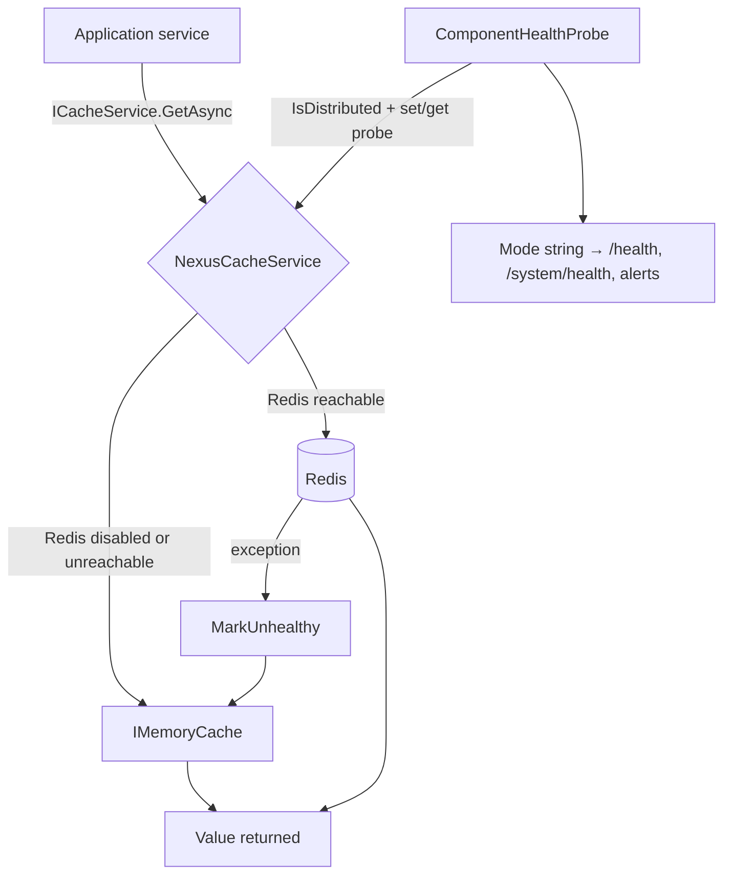

Implementation:

- `NexusCacheService` (singleton) prefers `IDistributedCache` (Redis) and demotes permanently to
  `IMemoryCache` on the first failure, logging once. It never throws to the caller.
- `Redis__Enabled` toggles `AddStackExchangeRedisCache` vs `AddDistributedMemoryCache`; setting it
  `false` removes the connection attempt entirely.
- Compose runs Redis 7 with `appendonly yes`, `maxmemory 256mb`, `allkeys-lru`.
- Health reports the active mode; the observability alerts list adds an `info` alert when Redis is not in
  use.

**Important:** the cache abstraction is implemented and wired, but **no business read path calls it
today**. Only the health probe performs real cache operations, and `ObservabilityService` reads `Mode` for
reporting. Enabling Redis therefore changes reported status and prepares the abstraction — it does not
currently make any query faster. Candidate targets and invalidation strategy are in
`docs/PERFORMANCE.md` §5.

---

## 11. Resilience: integrations and failure handling

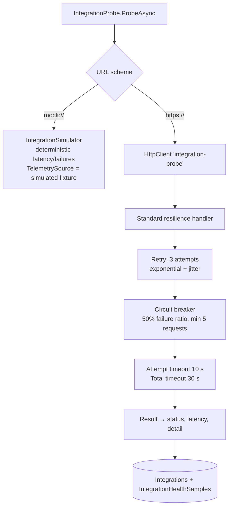

What is genuinely configured (`IntegrationServices/DependencyInjection.cs`,
`AddStandardResilienceHandler`):

| Setting | Value |
| --- | --- |
| Retry attempts | 3 |
| Backoff | Exponential with jitter |
| Circuit breaker | 50% failure ratio, minimum throughput 5 |
| Attempt timeout | 10 s |
| Total request timeout | 30 s |

What is **stored but not yet mapped into the pipeline**: each `Integration` row carries
`RetryMaxAttempts`, `RetryBaseDelayMs`, `MaxDelayMs`, `CircuitBreakerFailureThreshold` and
`CircuitBreakerBreakSeconds`. They are validated, persisted, returned by the API and shown in the UI, but
the resilience options above are fixed values. Wiring per-integration values into
`AddResilienceHandler` per client is the follow-up (proposed ADR-017); until then, do not describe the
per-integration retry columns as active.

Other failure behaviour:

| Dependency | Failure | Application behaviour |
| --- | --- | --- |
| Database | Unreachable | Host still starts; `/health` `unhealthy`; requests fail with 500 + correlation id |
| Redis | Unreachable/disabled | Permanent demotion to memory; `degraded`; never throws |
| Kafka | Unreachable/disabled | Outbox retries; publishes flagged simulated; `degraded` |
| Kafka consumer | Error | Heartbeat records the reason; lag grows; API unaffected |
| Outbox relay | Publish failure | `Attempts++`, exponential backoff, rows retained |
| Integration endpoint | Timeout/5xx | Probe records `Down`/`Degraded`; requests never block on it |
| Integration health worker | Cycle failure | Logged, heartbeat records failure count; API unaffected |

---

## 12. Database transaction boundaries

| Operation | Transaction | Rows touched |
| --- | --- | --- |
| Payment create | **One** `SaveChanges` | Payment, 4–6 PaymentEvents, 2 LedgerEntries, OutboxMessage, AuditLog, IdempotencyRecord, Account balances |
| Refund | One `SaveChanges` | Payment (refund), 2 events, 2 ledger entries, outbox, audit, account balance |
| Reversal | One `SaveChanges` | Payment status, event, 2 ledger entries, outbox, audit, balances |
| Integration create/update | One `SaveChanges` | Integration (+ audit entry) |
| Incident transition | One `SaveChanges` | Incident (+ activity, audit) |
| Event publish | One `SaveChanges` | KafkaEvent + AuditLog (delivery already attempted) |
| Outbox relay | Per cycle | Up to 25 outbox rows + produced KafkaEvents |
| Login | Two `SaveChanges` | Audit row committed first (evidence survives rejection), then refresh token + counters |

Explicitly **not** transactional across services: the outbox relay and integration probes run outside the
request transaction. That is the point — they are retried independently.

---

## 13. Module boundaries and their evolution

The eight operational modules (command centre, integration hub, API explorer, payment operations, event
streaming, observability, incidents, security centre) are **screens over shared application services**,
not separate deployables. Services own their use cases; there is no cross-service chat.

Extraction seams, in the order they would be pulled if the platform ever needed to split:

| Seam | Why it is the first candidate | Precondition |
| --- | --- | --- |
| Event relay / consumer | Its scaling is independent of request traffic | Leader election or partitioning of the outbox claim |
| Payments | Write-heavy, strict consistency, separate scaling and audit demands | Distributed transaction or saga, per-service ledger ownership |
| Telemetry / observability | Append-heavy, different read patterns (rollups, retention) | Move to a time-series store first |
| Integrations / probes | Outbound-egress heavy, benefits from its own network policy | Shared secret store for credentials |

There is no plan to split for its own sake. The modular monolith is a deliberate decision, not a
scaffold for microservices — see `docs/DECISIONS.md` ADR-001 and ADR-020.

---

## 14. Scalability considerations

**Scales horizontally as-is:** request serving. The API is stateless apart from per-process caches
(rate-limit windows, worker heartbeats, probe results), none of which is authoritative.

**Does not scale horizontally as-is:**

| Constraint | Effect | Fix |
| --- | --- | --- |
| Outbox worker has no leader election | Two instances publish the same rows | Claim/lease column, or a single worker replica |
| SQLite database | Single writer, file on ephemeral disk | Server-grade database |
| In-memory rate limiting | Limits are per instance | Distributed limiter backed by Redis |
| In-memory worker heartbeats | Health is per instance | Shared heartbeat store |
| In-memory cache fallback | Cache not shared | Enable Redis |

**Capacity envelope of the current build:** comfortable at demonstration volume (single-digit
concurrent operators, tens of requests per minute). It is not a capacity plan for a production estate, and
`docs/PERFORMANCE.md` explains how to measure the real one.

---

## 15. Frontend architecture

- **Server state** owned by TanStack Query with explicit keys and `placeholderData` for paging, so
  navigation does not flash empty tables.
- **Auth** is a context provider bootstrapping from stored tokens, validating them against `/auth/me`,
  and exposing `hasPermission`. Navigation and actions filter on the same permission codes the API
  enforces.
- **HTTP** is a ~100-line typed `fetch` wrapper: bearer header, problem-details parsing, single-flight
  refresh, sign-out event on repeated failure.
- **Design system**: CSS-variable tokens (`--brand`, `--surface`, `--line`, `--ink`, …) with light and dark
  themes, shared primitives built on Radix, reduced-motion support.
- **Signature interactions**: the integration network map (keyboard-selectable nodes with dependency
  detail), the payment journey timeline, and the command centre with alert-to-incident navigation.
- **Routing**: `BrowserRouter` with a `ProtectedRoute` guard; the server must serve `index.html` for
  unknown paths (SPA fallback), which is a deployment requirement in every environment.
