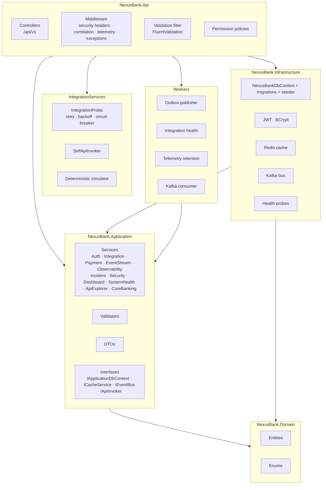
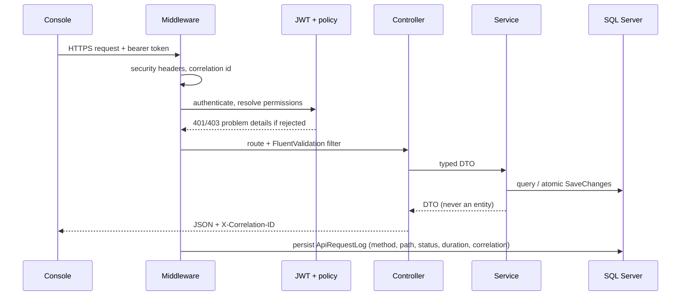
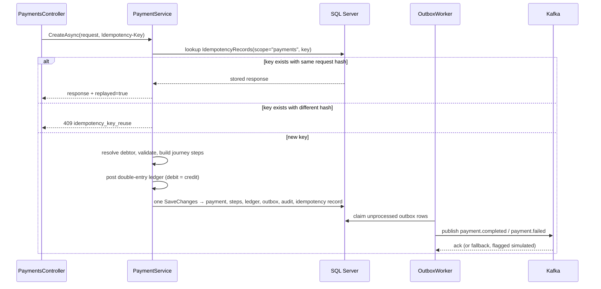
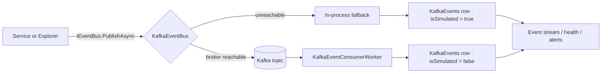

# Architecture

NexusBank is a **modular monolith**: one deployable API with hard internal boundaries, plus a
separate static console. The goal is enterprise clarity without the operational cost of services
that exist only to look distributed.

## 1. Layers

Rules that keep the boundaries honest:

- **Domain** has no dependencies; it holds entities, enums and domain rules only.
- **Application** depends on Domain and on interfaces it owns. It never references EF Core's
  provider, ASP.NET Core, Redis or Kafka. Services receive `IApplicationDbContext`,
  `ICurrentUser`, `ICacheService`, `IEventBus` and `IDateTimeProvider`.
- **Infrastructure** implements those interfaces. Only this project knows SQL Server, Redis, Kafka,
  BCrypt and JWT signing.
- **Api** composes everything, owns HTTP concerns, and contains no business rules.
- **Workers** are `BackgroundService` implementations, registered by the Api host.

There is exactly **one** DbContext abstraction (`IApplicationDbContext`) instead of a repository per
aggregate. EF Core is already a unit of work with query composition; wrapping it again would add
indirection without adding safety. Queries live in the service that owns the use case.

## 2. Request lifecycle

`RequestTelemetryMiddleware` writes one `ApiRequestLog` row per request. Every metric on the
dashboard and observability pages is aggregated from these rows — the charts cannot show invented
traffic.

Error handling is centralised in `ExceptionHandlingMiddleware`: domain exceptions map to
`400/401/403/404/409/429`, unexpected exceptions to a generic `500` with a correlation id and a
Serilog error entry. Stack traces never reach the client.

## 3. Payment write path (atomicity and idempotency)

A payment is one of the few multi-table operations in the platform, so it is the strictest:

Properties this guarantees:

- **All or nothing.** A failure between writing the payment and its ledger cannot happen: there is a
  single `SaveChanges`.
- **Replay-safe.** The same key and payload returns the original response (`replayed: true`); the
  same key with a different payload is a `409`.
- **Honest failure.** A rejected instruction still persists with `Failed`, a failure code, a reason
  and a journey that shows exactly where it stopped — with no ledger postings.
- **Balanced books.** `LedgerDebitTotal == LedgerCreditTotal`; the detail endpoint exposes
  `ledgerBalanced`.

Refunds and reversals follow the same pattern with their own guard rails (only completed payments
can be reversed; refunds cannot exceed the original amount).

## 4. Event flow and the fallback contract

`IEventBus` exposes `Mode` and `BrokerConnected`. Both the health centre and the event stream render
them verbatim: *"In-process development bus (Kafka disabled by configuration)"* is not dressed up
as a healthy broker. The same applies to Redis: when unreachable, `ICacheService` reports a memory
fallback and `/health` says so.

The outbox decouples "the business transaction committed" from "the broker accepted the message".
`OutboxPublisherWorker` claims pending rows, publishes, marks them processed, and increments
`Attempts` with a `NextAttemptAt` backoff on failure — so a broker outage delays events instead of
losing them.

## 5. Integrations

`IntegrationProbe` calls the configured health endpoint with:

- per-attempt timeout from the integration record,
- exponential backoff with jitter up to `MaxDelayMs`, bounded by `MaxAttempts`,
- a circuit breaker that opens after `CircuitBreakerFailureThreshold` consecutive failures and
  stays open for `CircuitBreakerBreakSeconds`.

URLs beginning with `mock://` are served by `IntegrationSimulator`, which derives deterministic
latency/failure behaviour from the integration key. Those records are flagged
`TelemetrySource = "simulated fixture"` and the UI labels them **FIXTURE**. Real `https://`
integrations are probed over the network and their samples are `live probe`.

`IntegrationHealthWorker` samples health on a schedule and stores `IntegrationHealthSamples`, which
feed the failure-rate and latency displays.

## 6. Observability

- **Logs**: Serilog structured console output, enriched with `service`, `CorrelationId` and
  `ClientIp`. The observability log feed is built from request telemetry plus audit entries so it is
  real data, not a static sample.
- **Metrics**: OpenTelemetry ASP.NET Core + HttpClient instrumentation, optional OTLP exporter.
  `/metrics` publishes a Prometheus text exposition built from persisted telemetry.
- **Traces**: request rows carry correlation ids, method, path, status, duration and service name,
  giving a usable trace list without a collector.
- **Health**: `/health` is anonymous and returns overall status plus component detail; `/health/live`
  is a liveness probe. Overall status is `unhealthy` only when the database or API is down,
  `degraded` when cache/broker/integrations are, otherwise `healthy`.

## 7. Frontend architecture

- **Server state** is owned by TanStack Query with explicit query keys and `placeholderData` for
  paging, so navigation does not flash empty tables.
- **Auth** is a context provider that bootstraps from stored tokens, validates them with
  `/auth/me`, and exposes `hasPermission`. Navigation and actions filter on the same permission
  codes the API enforces.
- **HTTP** is a small typed `fetch` wrapper with automatic single-flight refresh: a `401` triggers
  one refresh attempt, queued requests retry, and repeated failure clears the session with an event
  the provider listens for.
- **Design system**: token-driven (`--brand`, `--surface`, `--line`, `--ink`, …) with light and dark
  themes, a shared component kit, and reduced-motion support.
- **Signature interactions**: the integration network map (keyboard-selectable nodes, dependency
  detail), the payment journey timeline, and the operational command centre with alert-to-incident
  navigation.

## 8. Concurrency and background work

| Worker | Responsibility | Failure behaviour |
| --- | --- | --- |
| `OutboxPublisherWorker` | Publish committed outbox rows | Retries with backoff; rows stay pending |
| `IntegrationHealthWorker` | Sample integration health | Records the failure; never blocks requests |
| `TelemetryRetentionWorker` | Trim request logs and health samples | Logs and continues; bounded growth |
| `KafkaEventConsumerWorker` | Consume topics, track lag, dead-letter | Disabled when Kafka is disabled; state surfaced |

Each worker records a heartbeat in `WorkerHeartbeatRegistry`, which the system health page reads. A
worker with no heartbeat is reported as degraded rather than assumed running.

## 9. Scaling path

The monolith is stateless except for the database, cache and broker, so it scales horizontally.
Natural seams if it ever needs splitting: payments (write-heavy, strict consistency), event
processing (worker scale independent of API), and telemetry (append-heavy, read patterns differ).
Those are the boundaries to extract first — not one service per controller.
