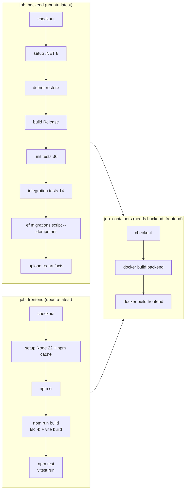

# CI/CD

What actually runs, what does not, and which gates are missing.

> **Scope.** The repository contains **one** workflow: `.github/workflows/ci.yml`. It builds, tests and
> builds container images. **There is no deployment workflow.** The Vercel and Render deployments are
> performed by each platform's own Git integration, outside GitHub Actions. No workflow run log is
> committed to this repository, so this document describes *what is defined*, not a recorded green
> build.

---

## 1. Source control workflow

| Aspect | Current state |
| --- | --- |
| Hosting | GitHub (`NexusBank-Enterprise-Intelligence-Platform`) |
| Default branch | `main` |
| Branching strategy | **Not formally defined.** No `CONTRIBUTING.md` rule, no branch protection documented, no release branches. Work lands on `main`. |
| Commit conventions | Descriptive imperative subjects (e.g. *"Add Vercel API rewrite to Render backend"*). Conventional Commits are not enforced. |
| Pull requests | The workflow triggers on `pull_request → main`, but no PR template, required reviewers or CODEOWNERS exist |
| Tags / releases | None. Version is a constant (`1.0.0`) in `IApplicationInfo` and the frontend footer |
| Changelog | Created alongside this audit (`CHANGELOG.md`), maintained by hand from this point |

For an enterprise review, this is the weakest part of the delivery story: a single long-lived branch with
no enforced review gate. See §7 for the recommendation.

---

## 2. Pipeline as defined

Triggers: `push` to `main`, `pull_request` targeting `main`, and manual `workflow_dispatch`.

### Stage detail

| Stage | Command | Gate? | Notes |
| --- | --- | --- | --- |
| .NET restore | `dotnet restore NexusBank.sln` | Yes (fails job) | Restores all 7 projects + 2 test projects |
| Backend build | `dotnet build -c Release --no-restore` | Yes | Step is named "warnings are not ignored", but `Directory.Build.props` sets `TreatWarningsAsErrors=false`, so **warnings do not fail the build**. NU1902 and CS8604 currently pass through. |
| Unit tests | `dotnet test NexusBank.Tests` | Yes | 36 tests, Release, `--no-build` |
| Integration tests | `dotnet test NexusBank.IntegrationTests` | Yes | 14 tests via `WebApplicationFactory`; sets `ASPNETCORE_ENVIRONMENT=Development` |
| Migration check | `dotnet ef migrations script --idempotent` then `test -s` | Yes | Proves the model still produces a non-empty SQL Server script — catches a model change without a migration |
| Test artefacts | `actions/upload-artifact@v4` (`if: always()`) | No | `.trx` files retained for diagnosis |
| Frontend install | `npm ci` | Yes | Lockfile-enforced, cached on `package-lock.json` |
| Frontend build | `npm run build` = `tsc -b && vite build` | Yes | Type errors stop the build |
| Frontend tests | `npm test` = `vitest run` | Yes | 19 tests, jsdom |
| API image | `docker build -t nexusbank-api:ci ./backend` | Yes | Build only — image is **not** pushed anywhere |
| Console image | `docker build -t nexusbank-web:ci ./frontend` | Yes | Build only — not pushed |

Both container builds wait for `backend` and `frontend` to succeed (`needs: [...]`).

### What the pipeline does not do

- No deployment of any kind (no Azure, Vercel or Render step).
- No image registry push, no image scanning, no SBOM.
- No `dotnet format`, no Roslyn analyzers, no frontend ESLint/Prettier step (there is no ESLint
  configuration in the repository).
- No coverage collection or threshold.
- No Playwright end-to-end run (the specs exist but need two live servers).
- No dependency vulnerability audit in CI, no Dependabot configuration, no secret scanning
  configuration, no dependency-review action.
- No performance smoke test.

---

## 3. Build settings that affect CI

| Setting | Value | Effect |
| --- | --- | --- |
| `TargetFramework` | `net8.0` (`Directory.Build.props`) | CI installs `8.0.x`; the repo also builds under a .NET 9 SDK locally |
| `Nullable` | enable | Nullable warnings are surfaced but not fatal |
| `TreatWarningsAsErrors` | **false** | Warnings, including `NU1902`, do not fail CI |
| Node | 22 | `npm ci` against the committed lockfile |
| Frontend build | `tsc -b && vite build` | Types are a hard gate; the bundle-size warning is raised to 900 kB rather than split |

---

## 4. Deployment: how it actually happens

### 4.1 Frontend — Vercel

- Vercel project watches the repository and builds the `frontend` directory (`npm run build` → `dist`).
- Production URL: `https://nexus-bank-sand.vercel.app`.
- `frontend/vercel.json` holds two things that are **deployment configuration, not application code**:
  1. a proxy rewrite `/api/:path*` → `https://nexusbank-api-w53j.onrender.com/api/:path*`;
  2. an SPA fallback rewrite so client-side routes such as `/login` are served `index.html`.
- Every push to `main` produces a deployment; preview deployments are created for other branches/PRs per
  Vercel defaults.
- Rollback: Vercel → Deployments → promote a previous production deployment. Instant, no rebuild.
- **Environment variables:** none are required. The console calls same-origin `/api/*` and relies on the
  rewrite; if a direct API origin were ever needed, `VITE_API_BASE_URL` is declared in
  `src/vite-env.d.ts` but **not read by the API client** (the client uses relative paths).

### 4.2 Backend — Render

- Render web service builds from the repository (Dockerfile at `backend/Dockerfile` or the .NET runtime
  buildpack) and exposes the ASP.NET Core host.
- URL: `https://nexusbank-api-w53j.onrender.com`.
- Free instance: spins down when idle, so the first request after a quiet period is slow (cold start).
- Rollback: Render → service → Deploys → roll back to a previous deploy.
- Configuration lives in Render environment variables, never in the repository. Known keys for the
  hosted profile (values are secrets and are **not** recorded here): `Jwt__SigningKey`,
  `Jwt__Issuer`, `Jwt__Audience`, `Database__Provider`, `ConnectionStrings__Sqlite`,
  `Cors__AllowedOrigins__0`, `Redis__Enabled`, `Kafka__Enabled`, `ASPNETCORE_ENVIRONMENT`.
- Redis and Kafka are disabled in this deployment for cost optimisation; the API reports the fallbacks
  in `/health`.

### 4.3 Why not "CI/CD" in the strict sense

The pipeline is **CI**: it proves the code builds and the tests pass. **D**elivery is delegated to the
two platforms' Git integrations. That is a legitimate pattern for a small system, but it means:

- a red build on `main` does not block a Vercel/Render deploy unless the platform is told to wait for
  checks;
- there is no environment promotion (`staging` → `production`);
- there is no deployment gate, smoke test or automatic rollback on failed health checks.

---

## 5. Environment configuration by stage

| Setting | Local (`dotnet run`) | Compose | Render (hosted) |
| --- | --- | --- | --- |
| `ASPNETCORE_ENVIRONMENT` | `Development` | `Production` | `Production` |
| `Database__Provider` | `Sqlite` | `SqlServer` | `Sqlite` |
| `Database__AutoMigrate` / `AutoSeed` | `true` / `true` | `true` / `true` | `true` / `true` |
| `Jwt__SigningKey` | Development fallback (startup refuses it outside Development) | `.env` → `JWT_SIGNING_KEY` | Render env var |
| `Redis__Enabled` | `false` | `true` | off / unreachable → memory fallback |
| `Kafka__Enabled` | `false` | `true` | `false` |
| `Cors__AllowedOrigins__0` | `http://localhost:5173` (via Vite proxy, so CORS is rarely exercised) | `http://localhost:8088` | Vercel origin |

---

## 6. Rollback strategy

| Layer | Mechanism | Preconditions |
| --- | --- | --- |
| Console | Vercel promote previous deployment | None (static) |
| API | Render roll back deploy | Database changes must be backward compatible |
| Containers | Redeploy previous image tag/digest | Tags must be immutable (use digests) |
| Schema | `dotnet ef database update <PreviousMigration>` | Expand/contract discipline; never a destructive change in the same release |
| Configuration | Revert env var + redeploy | Missing `Jwt__SigningKey` fails startup by design |

The migration rule is the one that matters: **add → backfill → switch reads → remove later**. A rollback
is only safe if the previous application version can run against the current schema.

---

## 7. Recommended additions (proposals, not implemented)

Ordered by value to an enterprise reviewer.

**Security and supply chain**

1. `dotnet list package --vulnerable --include-transitive` and `npm audit --audit-level=high` as CI
   steps (currently the known `OpenTelemetry.Exporter.OpenTelemetryProtocol 1.9.0` advisory is visible
   only as a build warning).
2. `.github/dependabot.yml` for `nuget`, `npm`, `docker` and `github-actions` ecosystems.
3. `actions/dependency-review-action` on `pull_request` to block new vulnerable dependencies.
4. GitHub **secret scanning** + **push protection** enabled at repository level (no code change needed).
5. Trivy or Grype scan of both built images; upload an SBOM (`anchore/sbom-action`).
6. `dotnet format --verify-no-changes` and ESLint + Prettier check, so style is a gate rather than a
   review comment.

**Quality**

7. Coverage with a floor (start low, ratchet): `--collect:"XPlat Code Coverage"` for xUnit and
   `vitest --coverage`, published as an artifact.
8. A Playwright job that starts the API (SQLite) and Vite preview, then runs the existing specs — the
   specs exist and are currently unexecuted.
9. `TreatWarningsAsErrors` for the library projects (keep the API tolerant initially), or at least
   `-warnaserror:NU1902`.

**Delivery**

10. Make deploys wait on CI: Vercel "wait for build checks", Render auto-deploy gated on the GitHub
    check.
11. A post-deploy smoke test (`/health`, login, one payment create + idempotent replay) that fails the
    deployment on error.
12. Immutable image publishing to GHCR with digest-pinned deploys.
13. A `staging` environment with its own database and secrets before production.

None of the above is claimed as done. They are the deltas between the current pipeline and what the
documentation claims about it.
