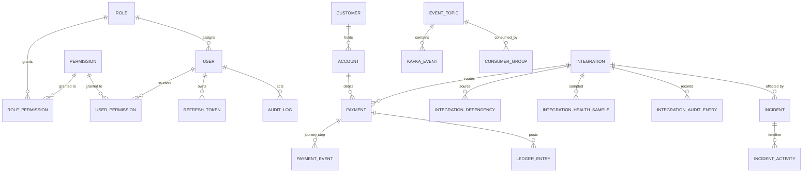

# Database design

SQL Server is the provider of record. The EF Core model is the single source of truth: the SQL
Server migration under `backend/NexusBank.Infrastructure/Migrations` is generated from it, and
SQLite (local development and tests) runs the same model through `EnsureCreated`.

## 1. Conventions

| Concern | Convention |
| --- | --- |
| Keys | `Guid` primary keys generated in the entity (`Guid.NewGuid()`), so ids exist before the write |
| Money | `decimal(18,2)` — never floating point in storage or arithmetic |
| Time | `DateTimeOffset` everywhere; SQL Server stores native `datetimeoffset` |
| SQLite time | The context enables `DateTimeOffsetToBinaryConverter` **only** for SQLite (no native type), so ordering and range predicates work |
| Enum storage | Persisted as integers; serialised as strings by the API (`JsonStringEnumConverter`) |
| Strings | Explicit `HasMaxLength`; required fields are `IsRequired()` |
| Naming | PascalCase tables and columns, `{Entity}Id` foreign keys |
| Deletes | Integrations and users are soft-disabled where history matters; payments and audit records are never deleted |
| Audit | Append-only `AuditLogs`; nothing in the application updates or deletes them |

## 2. Entity relationship diagram



## 3. Tables

### Identity and security

| Table | Purpose | Key columns / indexes |
| --- | --- | --- |
| `Users` | Platform operators | unique `Email` (256); `DisplayName`, `PasswordHash` (BCrypt), `RoleId`, `IsActive`, `FailedLoginAttempts`, `LockoutEnd`, `LastLoginAt` |
| `Roles` | Administrator, Operations, Developer, Auditor | unique `Slug` |
| `Permissions` | Permission catalogue (`payments:write`, `security:read`, …) | unique `Code` |
| `RolePermissions` | Role → permission join | composite PK |
| `UserPermissions` | Explicit per-user grant layered on the role | composite PK |
| `RefreshTokens` | Rotating sessions | index `TokenHash`, index `(UserId, ExpiresAt)`; only the SHA-256 hash is stored |
| `AuditLogs` | Append-only security and business audit | index `Timestamp`, index `(ActorEmail, Timestamp)`; `Action`, `EntityType`, `EntityId`, `Outcome`, `Severity`, `IpAddress`, `CorrelationId`, `Metadata` |

### Integrations

| Table | Purpose | Key columns / indexes |
| --- | --- | --- |
| `Integrations` | Registered banking services | unique `Key` (64), index `Status`; `BaseUrl`, `AuthType`, `SecretReference` (a reference only, never a secret), `RetryPolicy` columns, `TimeoutSeconds`, `LastSuccessAt`, `LastFailureAt`, `FailureRatePct` |
| `IntegrationDependencies` | Directed edges of the service graph | unique `(SourceIntegrationId, TargetIntegrationId)` |
| `IntegrationHealthSamples` | Probe history | index `(IntegrationId, Timestamp)`; `LatencyMs`, `Success`, `StatusCode`, `TelemetrySource` |
| `IntegrationAuditEntries` | Configuration change history | index `(IntegrationId, Timestamp)` |

`TelemetrySource` distinguishes `simulated fixture` (`mock://` URLs) from `live probe`
(`https://` URLs). It is surfaced in the API and labelled in the UI.

### Banking

| Table | Purpose | Key columns / indexes |
| --- | --- | --- |
| `Customers` | Synthetic retail and business customers | unique `CustomerNumber`; `Segment`, `KycStatus`, `IsActive` |
| `Accounts` | Accounts held by customers | unique `AccountNumber`; `Currency`, `Balance`, `AvailableBalance`, `Status` |
| `Payments` | Payment instructions | indexes on `Reference`, `CreatedAt`, `Status`; `IdempotencyKey`, `CorrelationId`, `RiskScore`, `ProcessingDurationMs`, `FailureCode`, `FailureReason` |
| `PaymentEvents` | Ordered journey steps | index `(PaymentId, Sequence)`; `Step`, `Status`, `ServiceName`, `Timestamp`, `DurationMs`, `ErrorDetail` |
| `LedgerEntries` | Simplified double-entry postings | index `PaymentId`; `EntryType` (Debit/Credit), `AccountNumber`, `Amount`, `Currency` |

### Messaging and platform

| Table | Purpose | Key columns / indexes |
| --- | --- | --- |
| `EventTopics` | Topic registry | unique `Name`; `Partitions`, `RetentionHours`, `OwnerTeam` |
| `KafkaEvents` | Produced/consumed messages with payload and failure detail | indexes on `Topic`, `ProducedAt`, `Status`; `IsSimulated`, `RetryCount`, `Error`, `ConsumerGroup` |
| `ConsumerGroups` | Group health | `GroupId`, `Topic`, `State`, `Members`, `Lag`, `CommittedOffset`, `LastHeartbeatAt` |
| `Incidents` | Operational incidents | unique `Reference`; `Severity`, `Status`, `Category`, `Team`, `Assignee`, `DetectedAt`, `AcknowledgedAt`, `ResolvedAt`, `RootCause`, `CorrectiveActions` |
| `IncidentActivities` | Timeline entries | index `(IncidentId, Timestamp)`; `Type`, `Detail`, `Author` |
| `ApiRequestLogs` | Telemetry source of truth | indexes on `Timestamp` and `Path`; `Method`, `StatusCode`, `DurationMs`, `CorrelationId`, `ServiceName` |
| `OutboxMessages` | Transactional outbox | index `(ProcessedAt, NextAttemptAt)`; `Type`, `Topic`, `Payload`, `Attempts`, `Error` |
| `IdempotencyRecords` | Stored responses for replay | unique `(Scope, Key)`; `RequestHash`, `StatusCode`, `ResponseJson`, `ExpiresAt` |

## 4. Integrity rules enforced in code

Database constraints cover shapes (lengths, uniqueness, required values). Cross-row invariants are
enforced in the application layer inside a single transaction:

1. **Balanced postings** — a completed payment's debit total equals its credit total.
2. **Account status** — a debtor account must be `Active` and funded; overdraft is not modelled.
3. **Currency match** — debtor account currency must equal the instruction currency.
4. **Immutable history** — payment events and ledger entries are inserted, never updated.
5. **Idempotent replay** — `(Scope, Key)` identifies a stored response; a different request hash is a
   conflict rather than a silent second payment.
6. **Incident state machine** — `Open → Acknowledged → Investigating → Mitigated → Resolved`, with
   timeline entries written for each transition.

## 5. Migrations

```bash
cd backend
export PATH="$PATH:$HOME/.dotnet/tools"        # dotnet-ef 8.0.11

dotnet ef migrations list  --project NexusBank.Infrastructure --startup-project NexusBank.Api
dotnet ef database update  --project NexusBank.Infrastructure --startup-project NexusBank.Api
dotnet ef migrations add AddSettlementWindow \
  --project NexusBank.Infrastructure --startup-project NexusBank.Api
dotnet ef migrations script --idempotent \
  --project NexusBank.Infrastructure --startup-project NexusBank.Api -o migration.sql
```

The committed initial migration is `20261113172523_InitialCreate`. Production deployments should
apply the idempotent script through a release step (or `Database__AutoMigrate=true` for a
single-instance rollout), never by dropping and recreating the database.

## 6. Seed data

`NexusBankSeeder` runs once when the database is empty (`Database__AutoSeed=true`) and is
idempotent:

- **6 operators** across four roles (password `NexusBank!2026`, hashed at seed time).
- **8 integrations** covering core banking, payments, cards, risk, data and an external gateway,
  each with 24 hours of health samples, dependencies and audit history.
- **12 customers / ~20 accounts** with NZ-style numbers, segments and KYC states.
- **240 payments** across all statuses and channels, each with 4–6 journey steps and ledger
  postings; failed ones carry failure codes and reasons.
- **6 topics / ~288 events** including consumed, retried and dead-lettered messages with payloads.
- **8 incidents** with realistic severities, owners and multi-entry timelines.
- **A rolling 48-hour request-log history** that makes traffic, latency and error charts meaningful
  on first load.

To reseed locally, stop the API and delete `backend/NexusBank.Api/nexusbank-dev.db*`, then start it
again. In Docker, `docker compose down -v` removes the SQL Server volume.

## 7. Retention and growth

`TelemetryRetentionWorker` trims `ApiRequestLogs` and `IntegrationHealthSamples` beyond their
retention window so a long-running demo does not grow without bound. `IdempotencyRecords` expire
after 24 hours; `RefreshTokens` expire after 7 days or when revoked. Audit records are retained.

For a production-scale estate the next steps would be table partitioning on `ApiRequestLogs` by
month, a columnstore index for analytics, and moving telemetry to a time-series store — see
`docs/DECISIONS.md`.
