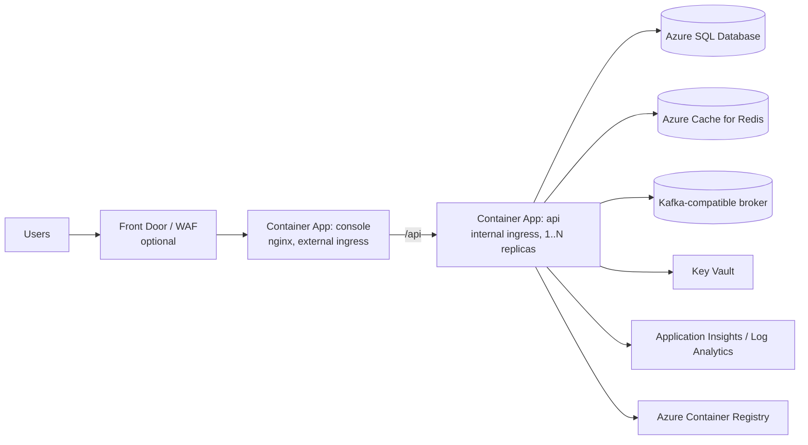

# Deployment

Three supported paths: local development, Docker Compose, and Azure (recommended: Container Apps).
Nothing in this document describes a live deployment — no cloud environment has been provisioned
for this repository.

---

## 1. Local development

```bash
cd backend
ASPNETCORE_ENVIRONMENT=Development ASPNETCORE_URLS=http://localhost:8080 \
  dotnet run --project NexusBank.Api --no-launch-profile
```

```bash
cd frontend && npm install && npm run dev
```

Open http://127.0.0.1:5173 and sign in with `admin@nexusbank.dev` / `NexusBank!2026`.

Development uses SQLite (`Database__Provider=Sqlite`), seeds on first run and disables Redis and
Kafka, so the platform starts with only the .NET SDK and Node installed.

---

## 2. Docker Compose

Prerequisites: Docker Desktop or Docker Engine with Compose v2, 6 GB free RAM (SQL Server is the
greedy one).

```bash
cp .env.example .env
# edit .env: MSSQL_SA_PASSWORD (strong), JWT_SIGNING_KEY (openssl rand -base64 48)

docker compose up --build
docker compose ps          # wait for api/web to report healthy
```

| URL | Service |
| --- | --- |
| http://localhost:8088 | Console (nginx) |
| http://localhost:8080/swagger | API documentation |
| http://localhost:8080/health | Health |
| http://localhost:1433 | SQL Server (sa) |
| http://localhost:6379 | Redis |
| http://localhost:9092 | Kafka bootstrap |

What happens on start:

1. SQL Server, Redis and Kafka start with health checks (Kafka ~30 s to elect its KRaft controller).
2. The API waits for SQL Server and Redis, applies EF migrations, seeds if empty, then serves 8080.
3. nginx serves the built SPA and proxies `/api`, `/health`, `/metrics` and `/swagger` to `api:8080`.

Useful commands:

```bash
docker compose logs -f api          # structured Serilog output
docker compose down                 # stop, keep data
docker compose down -v              # stop and delete volumes (reseed next start)
docker compose build --no-cache api
```

**Not verified here:** the Docker engine was unavailable in the authoring environment, so this stack
is provided and reviewed but not executed. If a service fails to start, check `docker compose logs`
for the first error — the most common causes are a weak `MSSQL_SA_PASSWORD` and a missing
`JWT_SIGNING_KEY`.

---

## 3. Recommended cloud target: Azure Container Apps

### Why this target

- The API is a stateless Linux container; the console is static files. Container Apps runs both with
  scale-to-zero, revision-based rollouts and built-in ingress — no cluster to operate.
- Managed backing services remove the operational burden of SQL Server, Redis and a broker: Azure SQL
  Database, Azure Cache for Redis, and a Kafka-compatible broker.
- Secrets live in Key Vault and are surfaced as Container Apps secrets (never baked into images).
- If the organisation already runs AKS, the same images deploy unchanged with the Helm/manifest
  alternative in §6.



### Prerequisites

- Azure subscription and `az` CLI logged in (`az login`), Docker for local builds.
- `terraform`/Bicep optional; the commands below are plain CLI so they are easy to follow.
- Permissions to create a resource group, ACR, SQL server, Redis, Container Apps environment.

### Step 1 — variables and resource group

```bash
RG=rg-nexusbank-dev
LOC=australiaeast
ACR=nexusbankacr$RANDOM
ENV=nexusbank-env
SQL_SERVER=nexusbank-sql-$RANDOM
SQL_DB=NexusBank
REDIS=nexusbank-redis-$RANDOM

az group create --name $RG --location $LOC
```

### Step 2 — container registry and images

```bash
az acr create --resource-group $RG --name $ACR --sku Basic --admin-enabled false
az acr build --registry $ACR --image nexusbank-api:1.0.0 ./backend
az acr build --registry $ACR --image nexusbank-web:1.0.0 ./frontend
```

`az acr build` builds in Azure, so no local Docker daemon is required — useful given Docker is not
available in this environment.

### Step 3 — Azure SQL

```bash
az sql server create --resource-group $RG --name $SQL_SERVER \
  --location $LOC --admin-user nexusadmin --admin-password '<strong-password>'

az sql db create --resource-group $RG --server $SQL_SERVER --name $SQL_DB \
  --service-objective S1 --backup-storage-redundancy Local

# Allow Azure services (Container Apps egress). Tighten with private endpoints for production.
az sql server firewall-rule create --resource-group $RG --server $SQL_SERVER \
  --name AllowAzureServices --start-ip-address 0.0.0.0 --end-ip-address 0.0.0.0
```

Connection string (stored as a secret, not in the image):

```
Server=tcp:<server>.database.windows.net,1433;Database=NexusBank;User Id=nexusadmin;Password=<password>;Encrypt=True;TrustServerCertificate=False;
```

Apply the schema. Either let the first API revision migrate (`Database__AutoMigrate=true`), or run a
one-off job:

```bash
az containerapp job create --name nexusbank-migrate --resource-group $RG \
  --environment $ENV --trigger-type Manual \
  --image $ACR.azurecr.io/nexusbank-api:1.0.0 \
  --command "dotnet" "ef" "database" "update" \
  --env-vars Database__Provider=SqlServer ConnectionStrings__SqlServer=secretref:sql-connection
```

The idempotent script from `dotnet ef migrations script --idempotent` can also be reviewed and run by
a DBA — that is the preferred path in regulated environments.

### Step 4 — Redis

```bash
az redis create --resource-group $RG --name $REDIS --location $LOC \
  --sku Basic --vm-size c0 --enable-non-ssl-port false
```

Redis requires TLS by default: set `Redis__Configuration` to
`<name>.redis.cache.windows.net:6380,password=<key>,ssl=True,abortConnect=False`.

If a managed Redis instance is not justified for a demo, deploy with `Redis__Enabled=false`; the API
reports the in-memory fallback explicitly instead of pretending a distributed cache exists.

### Step 5 — Kafka-compatible broker

The Kafka client in this build is configured for a plaintext bootstrap server. Two workable options:

| Option | What to do |
| --- | --- |
| **Confluent Cloud** (fastest) | Create a Basic cluster and a `payments.events` topic; set `Kafka__BootstrapServers` to the SASL_SSL endpoint and add SASL settings (see note) |
| **Event Hubs (Kafka surface)** | Create a Standard namespace + event hub; use the Kafka endpoint on 9093 |
| **Self-managed on AKS** | Run Strimzi or Bitnami Kafka with `Kafka__BootstrapServers=kafka:9092` inside the cluster |

> **Gap to close for managed brokers:** `KafkaEventBus` currently sets only `BootstrapServers` and
> `ClientId`. SASL_SSL requires `SecurityProtocol`, `SaslMechanism`, `SaslUsername` and
> `SaslPassword`. Add these four fields to `KafkaOptions` and copy them into the producer/consumer
> configs (about 15 lines) before pointing at Event Hubs or Confluent Cloud. Until then, deploy with
> `Kafka__Enabled=false` or run Kafka on AKS; the platform labels the fallback honestly either way.

### Step 6 — Key Vault and secrets

```bash
KV=nexusbank-kv-$RANDOM
az keyvault create --resource-group $RG --name $KV --location $LOC

az keyvault secret set --vault-name $KV --name JwtSigningKey --value "$(openssl rand -base64 48)"
az keyvault secret set --vault-name $KV --name SqlConnection --value "<connection string>"
az keyvault secret set --vault-name $KV --name RedisConnection --value "<redis connection>"
```

Grant the Container Apps managed identity `Key Vault Secrets User` and reference secrets with
`secretref:` in the app configuration, or store them directly as Container Apps secrets.

### Step 7 — Container Apps environment and apps

```bash
az extension add --name containerapp --upgrade
az provider register --namespace Microsoft.App
az provider register --namespace Microsoft.OperationalInsights

az containerapp env create --name $ENV --resource-group $RG --location $LOC

# API — internal ingress, only reachable from the console app
az containerapp create --name nexusbank-api --resource-group $RG --environment $ENV \
  --image $ACR.azurecr.io/nexusbank-api:1.0.0 \
  --target-port 8080 --ingress internal --transport http \
  --min-replicas 1 --max-replicas 4 \
  --cpu 1.0 --memory 2.0Gi \
  --secrets sql-connection="<connection string>" \
            redis-connection="<redis connection>" \
            jwt-key="$(openssl rand -base64 48)" \
  --env-vars ASPNETCORE_ENVIRONMENT=Production \
             Database__Provider=SqlServer \
             Database__AutoMigrate=true \
             Database__AutoSeed=true \
             ConnectionStrings__SqlServer=secretref:sql-connection \
             Redis__Enabled=true \
             Redis__Configuration=secretref:redis-connection \
             Kafka__Enabled=false \
             Jwt__SigningKey=secretref:jwt-key \
             Jwt__Issuer=nexusbank-api \
             Jwt__Audience=nexusbank-console

# Console — external ingress; nginx proxies /api to the API app
az containerapp create --name nexusbank-web --resource-group $RG --environment $ENV \
  --image $ACR.azurecr.io/nexusbank-web:1.0.0 \
  --target-port 80 --ingress external --transport http \
  --min-replicas 0 --max-replicas 3 \
  --cpu 0.5 --memory 1.0Gi
```

The bundled `frontend/nginx.conf` proxies to the hostname `api`, which is correct inside Docker
Compose. In Container Apps, either:

- set the API app name to `api` in the same environment (Container Apps resolves app names inside an
  environment), or
- build the console with an nginx config whose `proxy_pass` points at the API app's internal FQDN
  (`https://nexusbank-api.internal.<env-domain>`), or
- skip proxying and set a public API origin, adding it to `Cors__AllowedOrigins__0` and to the
  console's API base URL.

Then fix CORS to the console's real origin:

```bash
WEB_FQDN=$(az containerapp show -n nexusbank-web -g $RG --query properties.configuration.ingress.fqdn -o tsv)
az containerapp update -n nexusbank-api -g $RG \
  --set-env-vars Cors__AllowedOrigins__0="https://$WEB_FQDN"
```

### Step 8 — verify

```bash
API_FQDN=$(az containerapp show -n nexusbank-api -g $RG --query properties.configuration.ingress.fqdn -o tsv)
curl -s https://$API_FQDN/health
curl -s -X POST https://$API_FQDN/api/v1/auth/login \
  -H 'Content-Type: application/json' \
  -d '{"email":"admin@nexusbank.dev","password":"NexusBank!2026"}'
```

Acceptance checks for the deployment:

1. `/health` returns `healthy` (or `degraded` with an explicit reason string).
2. Console loads over HTTPS; sign-in works; no CORS errors in the browser console.
3. A payment is created, its journey renders and the ledger is balanced.
4. The same `Idempotency-Key` replays instead of duplicating.
5. An auditor receives `403` on a write action.
6. Application Insights shows requests and dependencies; Key Vault shows secret reads.

### Step 9 — roll out and roll back

```bash
# new image → new revision
az containerapp update -n nexusbank-api -g $RG --image $ACR.azurecr.io/nexusbank-api:1.0.1

# list revisions, shift traffic back if needed
az containerapp revision list -n nexusbank-api -g $RG -o table
az containerapp ingress traffic set -n nexusbank-api -g $RG \
  --revision-weight nexusbank-api--<previous>=100
```

Run migrations before shifting traffic, or keep them backwards compatible for one revision
(expand/contract). Never auto-migrate from multiple replicas against a schema change that is not
additive.

### Cost and scaling notes

- Container Apps scales to zero for the console; keep the API at `min-replicas 1` to avoid cold-start
  latency on the first dashboard load.
- Azure SQL S1 is enough for the demo volume; scale up for realistic traffic and enable auto-tuning.
- Redis Basic C0 is small and has no SLA — use Standard for anything beyond a demo.
- Kafka is the largest variable cost; Confluent Cloud Basic or a shared AKS cluster is usually cheaper
  than Event Hubs Standard for a portfolio workload.

---

## 4. Configuration matrix

| Setting | Local | Compose | Azure |
| --- | --- | --- | --- |
| `Database__Provider` | `Sqlite` | `SqlServer` | `SqlServer` |
| `ConnectionStrings__SqlServer` | unused | compose service | Azure SQL FQDN |
| `Redis__Enabled` | `false` | `true` | `true` (or `false` with fallback) |
| `Kafka__Enabled` | `false` | `true` | depends on broker choice |
| `Jwt__SigningKey` | dev fallback (Development only) | `.env` | Key Vault secret |
| `Cors__AllowedOrigins__0` | `http://localhost:5173` | `http://localhost:8088` | console FQDN |
| `Database__AutoMigrate` | `true` | `true` | `true` for first revision, then a job |
| `OpenTelemetry__OtlpEndpoint` | empty | empty | collector or App Insights exporter |

---

## 5. CI/CD

The included workflow builds and tests on every push and pull request. To add deployment, use
GitHub OIDC federation (no stored cloud password):

```yaml
permissions:
  id-token: write
  contents: read

jobs:
  deploy:
    runs-on: ubuntu-latest
    environment: production
    steps:
      - uses: actions/checkout@v4
      - uses: azure/login@v2
        with:
          client-id: ${{ secrets.AZURE_CLIENT_ID }}
          tenant-id: ${{ secrets.AZURE_TENANT_ID }}
          subscription-id: ${{ secrets.AZURE_SUBSCRIPTION_ID }}
      - run: az acr build --registry ${{ vars.ACR }} --image nexusbank-api:${{ github.sha }} ./backend
      - run: |
          az containerapp update -n nexusbank-api -g ${{ vars.RESOURCE_GROUP }} \
            --image ${{ vars.ACR }}.azurecr.io/nexusbank-api:${{ github.sha }}
```

Promote by digest, not by tag, and keep the previous revision warm for instant rollback.

---

## 6. Alternative: AKS with Helm

If the target organisation already operates Kubernetes:

1. Build and push the two images to ACR.
2. Create a namespace, a secret with the connection strings and JWT key (or use External Secrets →
   Key Vault).
3. Deploy the API as a `Deployment` (2+ replicas, `/health/live` liveness, `/health` readiness,
   `HorizontalPodAutoscaler` on CPU), a `ClusterIP` `Service`, and an `Ingress` for the console.
4. Serve the console as a separate `Deployment` with nginx, or host the built assets in blob storage +
   Front Door.
5. Run migrations as a Kubernetes `Job` before rollout (`dotnet ef database update` or the SQL script).
6. Add `NetworkPolicy` so only the console namespace can reach the API.

Helm charts and raw manifests are **not** included in this repository — the Compose stack and the
Container Apps commands above are the supported deployment paths. Adding a chart is a clean follow-up
if AKS is the real target.

---

## 7. Operations

| Concern | Action |
| --- | --- |
| Health | `/health/live` liveness, `/health` readiness + component truth, `/api/v1/system/health` for operators |
| Metrics | Scrape `/metrics`; `infrastructure/monitoring/prometheus.yml` has a starting configuration |
| Traces | Set `OpenTelemetry__OtlpEndpoint` to a collector (Jaeger, Tempo, App Insights agent) |
| Logs | Serilog JSON/console to the platform log sink; correlation id joins logs, audit and requests |
| Backups | Azure SQL automated backups + PITR; export Key Vault secrets to a recovery vault |
| Secrets | Rotate `JWT_SIGNING_KEY` on a schedule (invalidates sessions); rotate SQL/Redis credentials through Key Vault |
| Capacity | Scale API replicas on CPU/requests; SQL DTU/vCore; Redis tier |
| Incident response | Incidents in the app mirror real process: severity, owner, timeline, root cause, corrective actions |
| Data | All data is synthetic; never point this build at production banking systems |
