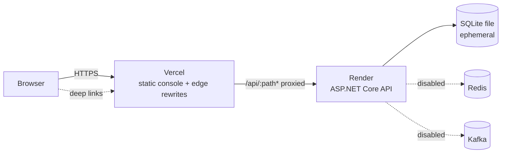
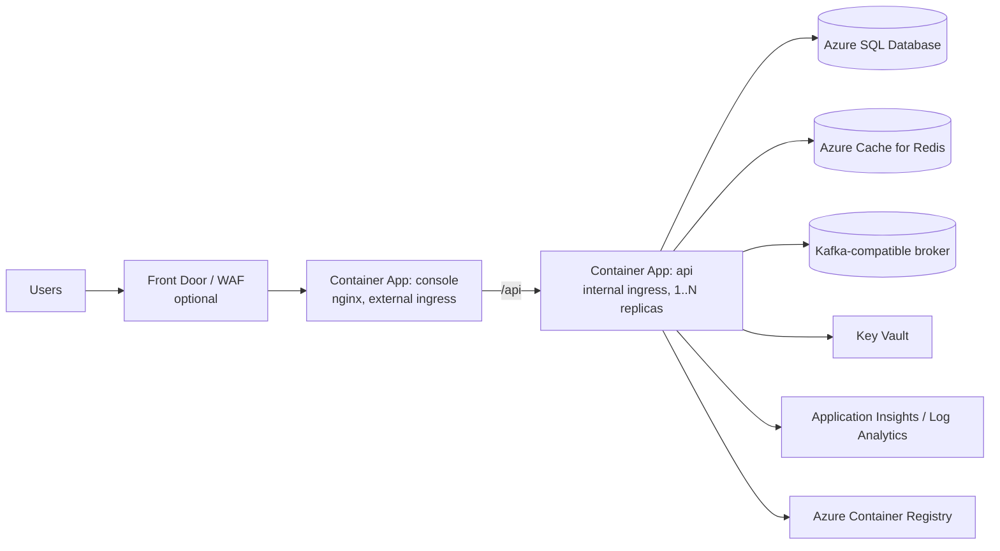

# Deployment

Two deployment shapes exist, and they are not interchangeable:

| | **A. Hosted demonstration** (current) | **B. Full infrastructure** (local/containers) |
| --- | --- | --- |
| Console | Vercel (static) | nginx container (`:8088`) |
| API | Render (single instance) | API container (`:8080`) |
| Database | **SQLite** file on the instance | **SQL Server 2022** |
| Redis | **Disabled** — in-process memory cache | **Redis 7** |
| Kafka | **Disabled** — in-process event bus | **Kafka 3.7** (KRaft) |
| Cost | Zero | Local machine resources (~6 GB RAM) |

A third target — **Azure Container Apps** — is documented as an optional future path in §4. **Nothing is
deployed on Azure.**

Terminology used throughout, and required for accuracy:

- Redis and Kafka are **implemented and available in the project**.
- Both are **supported in local/containerised environments**.
- Both are **disabled in the current Render deployment for cost optimisation**.

---

## 1. Current hosted deployment

### 1.1 Topology



### 1.2 Endpoints

| Purpose | URL |
| --- | --- |
| Console | `https://nexus-bank-sand.vercel.app` |
| API | `https://nexusbank-api-w53j.onrender.com` |
| Health (compact, anonymous) | `https://nexusbank-api-w53j.onrender.com/health` |
| Liveness | `https://nexusbank-api-w53j.onrender.com/health/live` |
| Prometheus metrics | `https://nexusbank-api-w53j.onrender.com/metrics` |
| Swagger UI | `https://nexusbank-api-w53j.onrender.com/swagger/index.html` |
| OpenAPI document | `https://nexusbank-api-w53j.onrender.com/swagger/v1/swagger.json` |
| Operator health (auth) | `https://nexusbank-api-w53j.onrender.com/api/v1/system/health` |

**Swagger is publicly reachable** in this deployment — convenient for review, and an information
disclosure to note in any real environment (`docs/SECURITY.md` §4.5).

### 1.3 Frontend — Vercel

| Property | Value |
| --- | --- |
| Project root | `frontend/` |
| Build | `npm ci` then `npm run build` (`tsc -b && vite build`) |
| Output | `dist/` |
| Runtime | Static; no server-side rendering |
| Environment variables | **None required.** The client uses relative `/api/...` paths |
| Routing | `frontend/vercel.json` — see below |

```json
{
  "rewrites": [
    { "source": "/api/:path*", "destination": "https://nexusbank-api-w53j.onrender.com/api/:path*" },
    { "source": "/((?!api/).*)", "destination": "/index.html" }
  ]
}
```

Two rewrites, two jobs:

1. **`/api/:path*` → Render.** Makes every API call same-origin from the browser: no CORS preflight, no API
   origin baked into the bundle.
2. **Catch-all → `/index.html`.** The console is a `BrowserRouter` SPA. Without this, any deep link —
   including `/login` — returns Vercel's 404 page instead of the application. *(Measured during this
   audit before the fallback existed: `/` → 200, `/login` → 404. The rewrite is now committed as
   `df9f471` and deployed: `/`, `/login`, `/payments`, `/events` and `/security` all return
   `200 text/html`.)*

`vercel.json` changes only take effect on a **new deployment**.

### 1.4 Backend — Render

| Property | Value |
| --- | --- |
| Runtime | ASP.NET Core 8 (`net8.0`), Linux container or .NET runtime |
| Port | Platform-provided; the app binds `ASPNETCORE_URLS` |
| Database | `Database__Provider=Sqlite`, file created on first boot |
| Migrations | `Database__AutoMigrate=true` → `EnsureCreated` for SQLite |
| Seeding | `Database__AutoSeed=true` → deterministic synthetic estate when empty |
| Environment | `ASPNETCORE_ENVIRONMENT=Production` |
| Redis | Disabled (no instance; memory cache serves) |
| Kafka | `Kafka__Enabled=false` |
| Startup guard | Refuses to start without `Jwt__SigningKey` outside Development |

Environment variables required (names only — values are secrets and are never recorded in this
repository):

```
ASPNETCORE_ENVIRONMENT
Jwt__SigningKey            # ≥ 32 bytes of entropy
Jwt__Issuer                # nexusbank-api
Jwt__Audience              # nexusbank-console
Database__Provider         # Sqlite
ConnectionStrings__Sqlite  # Data Source=nexusbank.db
Cors__AllowedOrigins__0    # https://nexus-bank-sand.vercel.app
Redis__Enabled             # false
Kafka__Enabled             # false
```

Optional: `OpenTelemetry__OtlpEndpoint`, `RateLimiting__PermitLimit`,
`RateLimiting__AuthPermitLimit`, `Api__SelfBaseUrl` (set this if the explorer's self-invocation needs a
fixed base URL; blank derives it from the incoming request).

### 1.5 Observed hosted behaviour (verified 2026-11-15)

```bash
curl -s https://nexusbank-api-w53j.onrender.com/health
```

```json
{
  "status": "degraded",
  "database": "connected",
  "cache": "In-process memory cache (Redis unreachable)",
  "eventBus": "In-process development bus (Kafka disabled by configuration)",
  "availabilityPct": 98.417,
  "uptimeSeconds": 1320,
  "checkedAt": "2026-11-15T13:56:33.3435366+00:00"
}
```

- `degraded` is **expected and correct**: the database is healthy, the cache and broker are deliberately
  absent.
- The authenticated `/api/v1/system/health` reports `environment: Production`, database mode
  `Microsoft.EntityFrameworkCore.Sqlite`, Redis `degraded`, Kafka `degraded`, and the Kafka consumer
  worker idle with *"Kafka disabled by configuration"*.
- `/metrics` returns Prometheus text; `/health/live` returns `{"status":"live"}`.
- Browser sign-in works end-to-end: `POST /api/v1/auth/login` → 200, then `/dashboard`,
  `/system/health`, `/observability/alerts` and `/incidents` all 200.

### 1.6 Verification procedure for this deployment

```bash
API=https://nexusbank-api-w53j.onrender.com
CONSOLE=https://nexus-bank-sand.vercel.app

# 1. process and dependency truth
curl -s -o /dev/null -w 'live %{http_code}\n'  $API/health/live
curl -s $API/health

# 2. the console's proxy actually reaches the API (expect 401, not 404/502)
curl -s -o /dev/null -w 'proxy %{http_code}\n' $CONSOLE/api/v1/auth/me

# 3. deep link is served the SPA (expect 200 after the fallback rewrite is deployed)
curl -s -o /dev/null -w 'login %{http_code}\n' $CONSOLE/login

# 4. end-to-end authentication with the seeded demo account
curl -s -X POST $API/api/v1/auth/login -H 'Content-Type: application/json' \
  -d '{"email":"ops@nexusbank.dev","password":"NexusBank!2026"}' | jq '{expiresAt, user: .user.email}'
```

Acceptance criteria: steps 1–3 return the noted statuses; step 4 returns a token and profile. A `degraded`
overall status is not a failure in this environment.

### 1.7 Limitations of the hosted deployment

| Limitation | Consequence | Mitigation if required |
| --- | --- | --- |
| SQLite on an ephemeral filesystem | All data created during a session is lost on redeploy/restart; the seeded estate returns | Attach a persistent disk, or move to a managed database |
| Redis disabled | No distributed cache; `/health` permanently `degraded`; cache not shared | Provision managed Redis, set `Redis__Enabled=true` + `Redis__Configuration` |
| Kafka disabled | Events are recorded with `isSimulated: true`; no broker fan-out | Provision a broker, set `Kafka__Enabled=true` + `Kafka__BootstrapServers` |
| Free instance cold start | First request after idle takes tens of seconds | Paid instance or a keep-warm probe |
| Single instance | Outbox relay is not leader-elected, so it cannot simply be replicated | Claim/lease column, or one worker replica |
| No backup | RPO is "since last boot" | `docs/DISASTER_RECOVERY.md` |
| Swagger public | API surface enumerable | Disable outside Development |
| Rate limits keyed on the proxy address | 12/min auth budget shared per proxy egress | Trusted forwarded-header configuration |
| No deployment pipeline | Platform Git integrations deploy; CI does not gate them | `docs/CI_CD.md` §7 |

### 1.8 Rollback

- **Console:** Vercel → Deployments → promote the previous production deployment. Instant, no rebuild.
- **API:** Render → service → Deploys → roll back to a previous deploy. The SQLite database reseeds if it
  was lost; schema changes must remain backward compatible so the previous API version can start.

---

## 2. Full infrastructure — Docker Compose

This is the only shape where Redis and Kafka actually execute.

### 2.1 Prerequisites

- Docker Desktop / Docker Engine with Compose v2.
- **~6 GB RAM available** (SQL Server is the greedy one; give Docker Desktop at least 6 GB).
- Ports `1433`, `6379`, `9092`, `8080`, `8088` free.

### 2.2 Start

```bash
cp .env.example .env
# edit .env:
#   MSSQL_SA_PASSWORD  — 8+ chars with upper, lower, digit, symbol (SQL Server rejects weak passwords)
#   JWT_SIGNING_KEY    — openssl rand -base64 48

docker compose up --build
docker compose ps        # wait for api/web to report healthy
```

Both variables are mandatory: Compose uses `${VAR:?message}` so it fails fast with a clear error if they
are missing. (`docker compose config` validates the file — verified in this repository.)

### 2.3 Services

| Service | Image | Purpose | Health check |
| --- | --- | --- | --- |
| `sqlserver` | `mcr.microsoft.com/mssql/server:2022-latest` | Provider of record | `sqlcmd SELECT 1`, 15 s interval, 12 retries |
| `redis` | `redis:7-alpine` | Distributed cache (AOF, 256 MB, allkeys-lru) | `redis-cli ping` |
| `kafka` | `bitnami/kafka:3.7` | Event broker (KRaft, 3 partitions, auto-create) | `kafka-topics.sh --list`, 30 s start period |
| `api` | `backend/Dockerfile` | ASP.NET Core API on `:8080` | `curl /health/live`, non-root `APP_UID` |
| `web` | `frontend/Dockerfile` | nginx serving the SPA, proxying `/api` | `wget --spider /` |

Start order is enforced by `depends_on` with health conditions: the API waits for **sqlserver** and
**redis** to be healthy and for **kafka** to have started; the console waits for the API to be healthy.

### 2.4 Runtime configuration inside Compose

| Variable | Value |
| --- | --- |
| `ASPNETCORE_ENVIRONMENT` | `Production` |
| `Database__Provider` | `SqlServer` |
| `ConnectionStrings__SqlServer` | `Server=sqlserver,1433;Database=NexusBank;User Id=sa;…;TrustServerCertificate=True` |
| `Redis__Enabled` / `Redis__Configuration` | `true` / `redis:6379` |
| `Kafka__Enabled` / `Kafka__BootstrapServers` | `true` / `kafka:9092` |
| `Cors__AllowedOrigins__0` | `http://localhost:8088` |
| `OpenTelemetry__OtlpEndpoint` | `${OTLP_ENDPOINT:-}` (empty by default) |

The `sa` account is used to keep local setup simple. A real deployment uses a least-privilege login — see
`docs/SECURITY.md` §7.

### 2.5 URLs and volumes

| URL | Service |
| --- | --- |
| http://localhost:8088 | Console (nginx) |
| http://localhost:8088/swagger | Swagger via the nginx proxy |
| http://localhost:8080 | API |
| http://localhost:8080/health | Health |
| http://localhost:8080/metrics | Prometheus text |
| `localhost:1433` | SQL Server (`sa`) |
| `localhost:6379` | Redis |
| `localhost:9092` | Kafka bootstrap |

Named volumes: `sqlserver-data`, `redis-data`, `kafka-data`. They survive `docker compose down` and are
destroyed by `docker compose down -v` (the next start reseeds).

### 2.6 Startup behaviour

1. SQL Server, Redis and Kafka start; Kafka needs ~30 s to elect its KRaft controller.
2. The API waits for its dependencies, applies EF migrations, seeds if the database is empty, then serves
   `:8080`.
3. nginx serves the built SPA and proxies `/api`, `/health`, `/metrics` and `/swagger` to `api:8080`
   (`frontend/nginx.conf` — hashed assets immutable for 1 year, `index.html` `no-store`, SPA fallback).

### 2.7 Operations

```bash
docker compose logs -f api            # structured Serilog output
docker compose logs -f kafka | tail   # broker readiness
docker compose stop api               # stop one service
docker compose down                   # stop, keep data
docker compose down -v                # stop and delete volumes (reseed next start)
docker compose build --no-cache api
curl -s http://localhost:8080/health  # expect cache "Redis (redis:6379)" and a connected Kafka mode
```

### 2.8 Common first-run failures

| Symptom | Cause | Fix |
| --- | --- | --- |
| `MSSQL_SA_PASSWORD` error | Variable unset or too weak | Set a policy-compliant password in `.env` |
| API exits at startup | `JWT_SIGNING_KEY` missing (fail-closed) | Set it in `.env` |
| API healthy, Kafka degraded | Broker still electing the controller | Wait, then restart the API so it re-probes |
| SQL Server restarts repeatedly | Docker has too little memory | Raise the Docker Desktop memory limit |
| Console loads, API calls 502 | API unhealthy / nginx started early | `docker compose ps`, then `docker compose restart web` |

### 2.9 Verification status

`docker compose config` **validates** with the required variables set, and CI builds both images. The
stack has **not** been started end-to-end during this audit — treat the first `docker compose up --build`
as an unverified step (see ADR-013).

---

## 3. Local development without containers

Fastest path; uses SQLite and disables Redis and Kafka.

```bash
# API
cd backend
ASPNETCORE_ENVIRONMENT=Development ASPNETCORE_URLS=http://localhost:8080 \
  dotnet run --project NexusBank.Api --no-launch-profile

# Console
cd frontend
npm install
npm run dev        # http://127.0.0.1:5173, proxies /api, /health, /metrics to :8080
```

Or both at once: `./scripts/dev.sh`.

The API creates `backend/NexusBank.Api/nexusbank-dev.db` on first run and seeds it. Delete that file to
reseed. `appsettings.Development.json` sets `Database:Provider=Sqlite`, `Redis:Enabled=false`,
`Kafka:Enabled=false` — the in-process fallbacks are what run locally.

Sign in with `admin@nexusbank.dev` / `NexusBank!2026` (all seeded accounts share that password).

---

## 4. Optional future target — Azure Container Apps

**Nothing is deployed on Azure.** This section is guidance for a real deployment, kept because the
architecture supports it unchanged: a stateless Linux container plus static files.

### 4.1 Why this target

- The API is a stateless Linux container; the console is static. Container Apps runs both with
  scale-to-zero, revision-based rollouts and built-in ingress — no cluster to operate.
- Managed backing services remove the operational burden: Azure SQL Database, Azure Cache for Redis and a
  Kafka-compatible broker.
- Secrets live in Key Vault and surface as Container Apps secrets, never baked into images.
- If the organisation already runs AKS, the same images deploy unchanged (§4.7).



### 4.2 Provision (abridged)

```bash
RG=rg-nexusbank-dev; LOC=australiaeast
ACR=nexusbankacr$RANDOM; ENV=nexusbank-env; SQL_SERVER=nexusbank-sql-$RANDOM
REDIS=nexusbank-redis-$RANDOM

az group create --name $RG --location $LOC
az acr create --resource-group $RG --name $ACR --sku Basic --admin-enabled false
az acr build --registry $ACR --image nexusbank-api:1.0.0 ./backend
az acr build --registry $ACR --image nexusbank-web:1.0.0 ./frontend

az sql server create -g $RG -n $SQL_SERVER -l $LOC \
  --admin-user nexusadmin --admin-password '<strong-password>'
az sql db create -g $RG -s $SQL_SERVER -n NexusBank --service-objective S1 \
  --backup-storage-redundancy Local
# Tighten with private endpoints for production.
az sql server firewall-rule create -g $RG -s $SQL_SERVER -n AllowAzureServices \
  --start-ip-address 0.0.0.0 --end-ip-address 0.0.0.0

az redis create -g $RG -n $REDIS -l $LOC --sku Basic --vm-size c0 --enable-non-ssl-port false
```

Redis requires TLS: `Redis__Configuration=<name>.redis.cache.windows.net:6380,password=<key>,ssl=True,abortConnect=False`.

**Kafka options.** The client is configured for a plaintext bootstrap server; it sets only
`BootstrapServers` and `ClientId`. Confluent Cloud or Event Hubs (Kafka surface) require
`SecurityProtocol`, `SaslMechanism`, `SaslUsername`, `SaslPassword` — four fields to add to `KafkaOptions`
and copy into the producer/consumer configs (~15 lines). Until then, deploy with `Kafka__Enabled=false` or
run Kafka on AKS. The platform labels the fallback honestly either way.

### 4.3 Deploy

```bash
az extension add --name containerapp --upgrade
az provider register --namespace Microsoft.App
az provider register --namespace Microsoft.OperationalInsights
az containerapp env create --name $ENV --resource-group $RG --location $LOC

az containerapp create --name nexusbank-api --resource-group $RG --environment $ENV \
  --image $ACR.azurecr.io/nexusbank-api:1.0.0 \
  --target-port 8080 --ingress internal --transport http \
  --min-replicas 1 --max-replicas 4 --cpu 1.0 --memory 2.0Gi \
  --secrets sql-connection="<connection string>" redis-connection="<redis connection>" \
            jwt-key="$(openssl rand -base64 48)" \
  --env-vars ASPNETCORE_ENVIRONMENT=Production \
             Database__Provider=SqlServer Database__AutoMigrate=true Database__AutoSeed=true \
             ConnectionStrings__SqlServer=secretref:sql-connection \
             Redis__Enabled=true Redis__Configuration=secretref:redis-connection \
             Kafka__Enabled=false \
             Jwt__SigningKey=secretref:jwt-key Jwt__Issuer=nexusbank-api Jwt__Audience=nexusbank-console

az containerapp create --name nexusbank-web --resource-group $RG --environment $ENV \
  --image $ACR.azurecr.io/nexusbank-web:1.0.0 \
  --target-port 80 --ingress external --transport http \
  --min-replicas 0 --max-replicas 3 --cpu 0.5 --memory 1.0Gi
```

`frontend/nginx.conf` proxies to the hostname `api`, which is correct inside Compose. In Container Apps,
either name the API app `api` in the same environment, or point `proxy_pass` at the API's internal FQDN, or
skip proxying and set a public API origin plus `Cors__AllowedOrigins__0`. Then fix CORS to the console's
real origin:

```bash
WEB_FQDN=$(az containerapp show -n nexusbank-web -g $RG --query properties.configuration.ingress.fqdn -o tsv)
az containerapp update -n nexusbank-api -g $RG --set-env-vars Cors__AllowedOrigins__0="https://$WEB_FQDN"
```

### 4.4 Verify and roll back

```bash
API_FQDN=$(az containerapp show -n nexusbank-api -g $RG --query properties.configuration.ingress.fqdn -o tsv)
curl -s https://$API_FQDN/health
curl -s -X POST https://$API_FQDN/api/v1/auth/login -H 'Content-Type: application/json' \
  -d '{"email":"admin@nexusbank.dev","password":"NexusBank!2026"}'

# roll out / roll back by revision weight
az containerapp update -n nexusbank-api -g $RG --image $ACR.azurecr.io/nexusbank-api:1.0.1
az containerapp revision list -n nexusbank-api -g $RG -o table
az containerapp ingress traffic set -n nexusbank-api -g $RG --revision-weight nexusbank-api--<previous>=100
```

Apply migrations before shifting traffic, or keep them backwards compatible for one revision
(expand/contract). Never auto-migrate from multiple replicas against a non-additive schema change.

### 4.5 Cost notes

Container Apps scales the console to zero; keep the API at `min-replicas 1` to avoid cold-start latency.
Azure SQL S1 suits demo volume. Redis Basic C0 has no SLA — use Standard beyond a demo. Kafka is the
largest variable cost.

### 4.6 Database migrations

Let the first revision migrate (`Database__AutoMigrate=true`), or run a one-off job:

```bash
az containerapp job create --name nexusbank-migrate --resource-group $RG --environment $ENV \
  --trigger-type Manual --image $ACR.azurecr.io/nexusbank-api:1.0.0 \
  --command "dotnet" "ef" "database" "update" \
  --env-vars Database__Provider=SqlServer ConnectionStrings__SqlServer=secretref:sql-connection
```

The idempotent script from `dotnet ef migrations script --idempotent` can be reviewed and run by a DBA —
the preferred path in a regulated environment.

### 4.7 AKS alternative

If the organisation already operates Kubernetes: build and push the two images; create a namespace and a
secret (or External Secrets → Key Vault); deploy the API as a `Deployment` (2+ replicas, `/health/live`
liveness, `/health` readiness, HPA on CPU) behind a `ClusterIP` `Service`; serve the console as a separate
`Deployment` with nginx or host the built assets in blob storage behind Front Door; run migrations as a
`Job`; add `NetworkPolicy` so only the console namespace reaches the API.

Helm charts and raw manifests are **not** included in this repository.

---

## 5. Configuration matrix

| Setting | Local (`dotnet run`) | Compose | Render (hosted) | Azure (target) |
| --- | --- | --- | --- | --- |
| `ASPNETCORE_ENVIRONMENT` | `Development` | `Production` | `Production` | `Production` |
| `Database__Provider` | `Sqlite` | `SqlServer` | `Sqlite` | `SqlServer` |
| `ConnectionStrings__*` | local file | compose service | instance file | Azure SQL FQDN (secret) |
| `Redis__Enabled` | `false` | `true` | **disabled** (cost) | `true` |
| `Kafka__Enabled` | `false` | `true` | **disabled** (cost) | depends on broker |
| `Jwt__SigningKey` | dev fallback (Development only) | `.env` | Render env var | Key Vault secret |
| `Cors__AllowedOrigins__0` | `http://localhost:5173` | `http://localhost:8088` | Vercel origin | console FQDN |
| `Database__AutoMigrate` | `true` | `true` | `true` | first revision, then a job |
| `OpenTelemetry__OtlpEndpoint` | empty | empty | empty | collector / App Insights |

---

## 6. Deployment checklist (either shape)

1. Secrets set and never committed: `Jwt__SigningKey` (≥32 bytes), database credentials, any broker
   credentials.
2. `Cors__AllowedOrigins__*` contains exactly the console origins in use.
3. Database reachable and migrated; `/health` reports `database: connected`.
4. Redis/Kafka state is intentional: either configured and reachable, or explicitly disabled — never
   "configured but silently failing".
5. Console deep links resolve (`/login` returns the SPA, not a platform 404).
6. Sign-in succeeds; a write is denied for a read-only account (`403`).
7. One payment creates, replays idempotently and reports `ledgerBalanced: true`.
8. `/metrics` is scraped or explicitly not required; `/health/live` is wired to the platform health check.
9. Swagger exposure is a deliberate decision.
10. Rollback path identified (previous deployment/revision) and schema changes are backward compatible.
